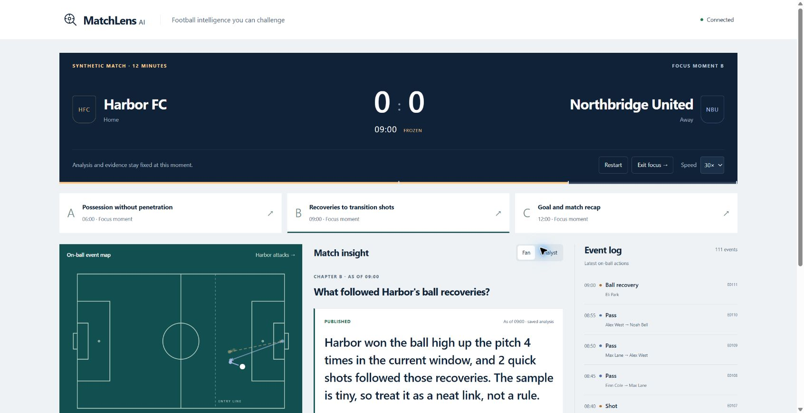
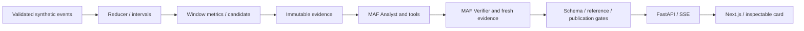

# MatchLens AI

**Football intelligence you can challenge.** Replay a continuous synthetic match, discover what changed, and inspect the events behind a real Analyst/Verifier explanation.

Repository: [Leionel/MatchLens](https://github.com/Leionel/MatchLens).

R0.1 uses Microsoft Agent Framework, DeepSeek Flash, FastAPI and Next.js. The match, statistics and publication predicates are deterministic; both agents use the actual model API. Public hosting and the final competition video are not yet available. See [actual execution results](docs/R0.1_RESULTS.md).



## Run locally

Tested on Windows with PowerShell, Python3.13.9, `uv`0.6.6, Node24.16.0 and npm. Use Node22+ / Python3.13. Dependencies are locked in `services/api/uv.lock` and `apps/web/package-lock.json`.

```powershell
Copy-Item .env.example .env
# Set DEEPSEEK_API_KEY in .env using your editor. Never put it in client config.
powershell -ExecutionPolicy Bypass -File scripts/run.ps1
```

Open **http://127.0.0.1:8000**. Subsequent starts can use `scripts/run.ps1 -SkipBuild`. Keep exactly one Uvicorn worker/replica. Without a key, the replay, statistics, source events and explicitly labeled fallback work; no model answer is simulated.

Other platforms:

```sh
uv sync --project services/api --frozen
npm --prefix apps/web ci
npm --prefix apps/web run build
cd services/api
uv run uvicorn matchlens.main:app --host 127.0.0.1 --port 8000 --workers 1
```

Development: start FastAPI as above and `npm --prefix apps/web run dev` in another terminal. Next's dev server proxies `/api`; the built application needs only Python at runtime.

## Try the football story

1. Focus **A · 06:00**. Compare Harbor's controlled possession against shots and attacking entries. Select **Analyse this moment** for a real pair of model calls/tools. Focus freezes the match while they work.
2. Read the actual decision. Select **Challenge with evidence**, choose a receipt, and click an event ID. Check its coordinates, original JSON and the highlighted pitch action. A zero count has no matching events; the whole prefix remains inspectable.
3. Switch **Fan / Analyst**. Both views use the same claim and refs, without new inference. Expand **View run trace** for the actual tools and handoff. **Overlay preview** reuses approved Fan text.
4. Focus **B · 09:00** and investigate the recorded recovery-to-shot chains. Association is not tactical causation. The agents may publish, qualify or withhold; no verdict is scripted.
5. Focus **C · 12:00** for the goal sequence and a recap of already accepted session insights. Old cards and evidence keep their original as-of times. Exit Focus to resume; pending old-epoch work cannot publish.

The replay is a **12-minute demonstration match**, not regulation football or live Premier League data. Harbor FC, Northbridge United and all players are fictional. Original SVG event map; no match footage or off-ball player tracking.

## How it works



The Analyst selects a useful interpretation; a fresh Verifier checks its precise prose against original evidence and opposing metrics. `qualify` can select a narrower supplied variant of the **same true core**. It cannot rescue a false core with a disclaimer. Independent program checks enforce the bounded assertion, snapshot, refs, scope, tool roundtrips, handoff and numeric slots. No third agent, RAG, cloud agent service or arithmetic delegated to an LLM.

JSON Object output is locally validated. At most one format correction per role, using the same role/session/evidence; no factual code repair or unbounded debate. Invalid/unfinished review yields statistics only. Detailed [contracts](docs/SPEC.md), [architecture](docs/ARCHITECTURE.md), [review](docs/R0.1_REVIEW.md) and historical [provider Spike](docs/TECH_SPIKE.md) are included.

## Tests and actual model runs

```powershell
Push-Location services/api
uv run pytest -q
Pop-Location
npm --prefix apps/web run typecheck
npm --prefix apps/web run build
# With the local server running and a funded key; incurs real inference:
services/api/.venv/Scripts/python.exe scripts/live_validation.py --out evidence/r0.1/my-run.json
```

Offline regressions prove event arithmetic, source boundaries, publication rules, persistent reservations and cancellation isolation. They do not prove football-language quality. Real HTTP reports and manual review are separate in [R0.1_RESULTS](docs/R0.1_RESULTS.md). S0/S1/M comparative study and external audience tests remain **NOT RUN**; no multi-agent quality uplift is claimed.

## Reliability, privacy and cost

Key is server-only in environment/root `.env` (ignored), never `NEXT_PUBLIC_*`. No public prompt/upload interface. Anonymous HttpOnly session, same-origin writes, fixed fixture/model/endpoint, finite session/IP/global rates, two workflow slots and one workflow/session. Focus analysis has a 25s model deadline plus up to 5s queue wait. A manual retry stays within budgets; no SDK auto-retries.

`.runtime/budget.sqlite3` reserves $0.02 before **every** dispatch, including tool continuations and format correction; failures/cancellation do not refund it. Default **32 requests / $1 total reservation ceiling**, whichever binds first. The peak-price byte/output bound is conservative; actual usage estimates are not invoices. Restart preserves the ledger and loses sessions. Do not delete/reset the ledger to bypass a budget. Configure an explicit additional allowance when needed.

Sanitized operator records in `.runtime/runs` contain raw/validated outputs and frozen evidence, never credentials or headers. Browser only sees accepted cards and sanitized trace summaries. Export relevant evidence before replacing a host/release. No calibrated xG, formations, pressing diagnosis, coaching intent or causal-effect estimates are supported.

## Deployment preparation

`Dockerfile` builds the static UI and runs one Python process. Container build/deployment are separate from the tested local static export; see results for actual status.

```sh
docker build -t matchlens:r01 .
docker run --rm -p 8000:8000 --env-file .env -v matchlens-data:/data/matchlens matchlens:r01
```

Choose an authorized funded host, preserve `/data/matchlens`, set one worker/replica and host rate protection. Verify actual DeepSeek egress and ten-minute public transport behavior there. Production budget/free judge access through Nov 10, a final release and <120s video remain release tasks in [ROADMAP](docs/ROADMAP.md) and [DEMO_PLAN](docs/DEMO_PLAN.md).

Code assistance: OpenAI Codex. Runtime orchestration: Microsoft Agent Framework. DeepSeek is the model provider. Foundry and GitHub Copilot SDK are not runtime dependencies. This project was developed for the 2026 Inside the Game Hackathon; retain truthful Git/release history and original run evidence.

## License

MIT. Synthetic events, fictional identities and interface assets are created within this project. Dependencies retain their own licenses. Official competition rules and Microsoft/Premier League names belong to their respective owners.
