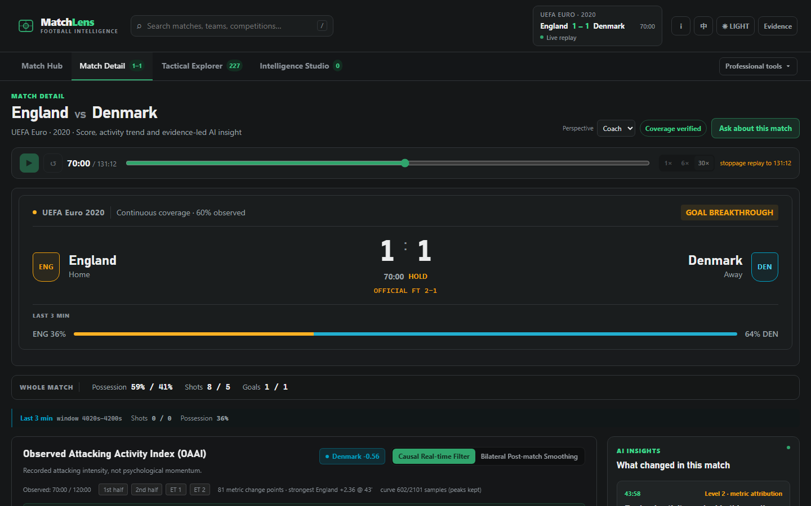

# MatchLens AI

### Football intelligence you can challenge.

[**Launch the live demo →**](https://p01--matchlens--zfs7xk57gw42.code.run)

A football explanation is only worth airing if someone can check it. MatchLens turns recorded match events into a claim, has a second agent try to break that claim, sends it through a publication gate, and lets you walk back to the exact events behind it — or challenge it.



The public Northflank deployment runs the judge journey anonymously with one real match (UEFA Euro 2020, England 2–1 Denmark) and the synthetic scenarios. The deterministic path needs no key, account or payment. Opt-in Real Agent runs use DeepSeek Flash when the server key and budget runway are available. Run locally in about three minutes (below) for the complete 80-match corpus.

**Demo video:** [MatchLens on YouTube](https://youtu.be/3q3_3A1fU6I) — a recorded walkthrough of the product loop: featured moment → investigation → evidence → gate → challenge.

---

## The 30-second version

Most football tools give you numbers. Most LLM wrappers give you confident prose. MatchLens is built around the gap between them:

| What usually happens | What MatchLens does instead |
| --- | --- |
| A model explains a moment. You either believe it or you do not. | A **Verifier** independently re-reads the same evidence, checks counterevidence, and can publish, narrow or withhold the claim. |
| Numbers appear without a scope. | Every number carries the window it was measured over. A three-minute reading is never shown as a match total. |
| "Possession is up" becomes "they are in control". | The claim is bounded to recorded events; off-ball shape and tactical cause are listed as *not inferable*. |
| An explanation cannot be argued with. | You can challenge a registered claim and read the resulting revision. |

That loop — **claim → verify → gate → evidence → challenge** — is the product. Everything else (match hub, tactical map, broadcast rundown) exists to give it somewhere real to land.

---

## What actually runs

Three different things are easy to confuse, so the product labels them everywhere:

| Layer | Status | How to see it |
| --- | --- | --- |
| **Deterministic engine** | Always on, free, no model call | The default investigation. Same input, same numbers, same conclusion. Every metric receipt is recomputed from the event log. |
| **Real MAF two-agent run** | Requires `DEEPSEEK_API_KEY` and budget runway | Choose *Real Agent (uses model budget)* under **Advanced** in Intelligence Studio. Analyst and Verifier are two `Executor`s in one Microsoft Agent Framework `WorkflowBuilder`, each with its own tool registry. |
| **Historical recorded model output** | Shipped as evidence, not re-run | `evidence/r0.2/runs/*.json`. Labelled as historical in the UI; never presented as a live run. |

The investigation panel says which of these produced the plan you are reading, and the agent panel shows **which tools each stage actually called** — or says plainly that no model was called. A failed agent run degrades to the deterministic plan and says so; it never fabricates agent output.

### Microsoft Agent Framework

`services/api/matchlens/agents.py` builds a real `Agent(client=OpenAIChatCompletionClient(...), tools=[...])` per stage and a `WorkflowBuilder(start_executor=analyst).add_edge(analyst, verifier)` for the classic analyse path. The investigation path (`services/api/matchlens/investigation.py`) runs the same two roles with the same binding rules:

```
Analyst  → tools it chose itself (max 12) → typed claim draft → SHA-256 handoff
Verifier → its own tools (max 6), including find_counterevidence → per-claim verdict
Gate     → refs, scope, slots, numeric binding, unsupported-language rules
```

The model can select tools; it cannot bypass the allow-list, per-tool budgets, receipt hashing, or the gate. One bounded format correction is allowed per stage, and it may not change the claim id, assertion or scope.

---

## Judge path (no key, no account)

```bash
git clone https://github.com/Leionel/MatchLens && cd MatchLens
uv sync --project services/api --frozen
npm --prefix apps/web ci && NODE_OPTIONS= npm --prefix apps/web run build
cd services/api && uv run uvicorn matchlens.main:app --host 127.0.0.1 --port 8000 --workers 1
```

Open **http://127.0.0.1:8000**. Then, in order:

1. **Match Hub** — real provider matches are listed first, each marked `Real data`; synthetic fixtures say `Demo`.
2. **Open a match** (1 click) — you land on Match Detail with the score, whole-match totals, a *separately labelled* live window, and the strongest recorded activity change.
3. **Investigate this change** (1 click) — the investigation runs at that exact moment and returns a conclusion, its evidence, alternative explanations, and what cannot be decided.
4. **Read the agent panel** — it tells you whether a model ran, which tools each stage called, and what the gate decided.
5. **Trace event** / **Back to this moment** — the result is bound to real events and to its own match time.
6. Optional: register the claim, then **challenge** it and read the revision.

Two clicks from the front page to a formed, gated conclusion. No producer token is needed for any of it; the broadcast preview is generated from the approved claim inside the studio.

To see the synthetic replay the brief asks for, open a `Demo · Synthetic` match from the hub and press play — a continuous 12-minute match, about 24 seconds at 30×.

---

## Data

| Source | What it is | How it gets here |
| --- | --- | --- |
| **Synthetic match engine** | 12-minute simulated fixtures with a continuous event stream, 7 scenarios | Generated deterministically in-process (`football.generate_match`), fictional teams and players. |
| **StatsBomb open data** | 80-match corpus across 15 competition-seasons (2010–2024), 302,638 events, all `COMPLETE_VERIFIED` | Licensed payloads are **not** committed. Fetch and import with `scripts/fetch_statsbomb_open_data.py` + `scripts/ingest_statsbomb_corpus.py`. |

The catalog distinguishes `CATALOGUED` (metadata only), `MATERIALIZED` (payload present, unverified) and `ANALYSIS_READY`. A match without a payload can never silently fall back to synthetic data.

---

## What this cannot do

Stated here because the product states it too, on screen, next to the claim:

- **No off-ball tracking.** Formation, pressing height, compactness and marking are not observed. The product refuses to draw 22-player defensive shapes.
- **No calibrated xG.** Chance quality is not modelled; no xG number is published as calibrated.
- **xT is a static grid**, not fitted on a complete corpus.
- **OAAI is a defined activity index**, not momentum and not causal. It is not a reverse-engineered copy of any commercial metric.
- **No causal claims.** Every registered claim is Level 1 (observed) or Level 2 (metric attribution). Level 3/4 require designs this data cannot support.
- **No multi-agent quality study has been run.** We do not claim a measured uplift over a single agent; the claim is architectural and inspectable.

---

## Verification

| Gate | Command | Result |
| --- | --- | --- |
| Backend | `services/api/.venv/Scripts/python.exe -m pytest services/api/tests/ -q` | 378 passed (CI green) |
| Types | `npm --prefix apps/web run typecheck` | 0 errors |
| Build | `NODE_OPTIONS= npm --prefix apps/web run build` | 0 errors |
| Browser | `npx playwright test` (in `apps/web`) | 50 passed / 1 skipped locally, green in CI |
| CI | GitHub Actions | [workflow](.github/workflows/ci.yml), latest run green |

The browser suite includes a **demo-path spec** that walks the journey above and writes the screenshots in `evidence/r6.2/`. The images in this README are produced by that test, not staged separately.

---

## Deployment (single container)

The app is packaged as **one container**: FastAPI serves the API and the static
Next.js export on one port, with one uvicorn worker and one volume. There is no
second service and no database.

```bash
docker build -t matchlens .
docker run --rm -p 8000:8000 -v matchlens-data:/data/matchlens matchlens
open http://127.0.0.1:8000
```

**Current production:** the Northflank single container at the Live demo URL above. **Render is the documented, tested hosting target** for a fresh paid deployment: import this GitHub repository as a Render Blueprint (`render.yaml` in the repo root): one paid Docker Web Service, a 1 GB disk mounted at `/data/matchlens`, and an HTTPS `onrender.com` address — the blueprint and this README's Docker quick-run are self-sufficient. Step-by-step Render/Railway walkthroughs are kept in a private operations folder rather than this public repository.

Provider payloads are licensed and are **not** in the image. On first boot the
container fetches one complete real match from the provider's public repository,
verifies it, and imports it onto the volume; until that finishes the synthetic
library is fully usable. The fetch is idempotent, bounded, and cannot fail the
boot.

**Deployment verification:** Docker CI builds and runs the actual image, tests the HTTP/API paths, imports a real match on a volume, and checks it survives a container restart. **Render itself has not yet been deployed or publicly tested.** A real public URL must be generated in Render and validated by the entrant; the demo video still needs to be recorded and published.

---

## Repository map

```
services/api/matchlens/
  football.py        reducer, windows, receipts (one formula per metric)
  metrics.py         metric registry, range queries, provenance
  oaai.py            activity index + contribution ledger
  investigation.py   deterministic planner, MAF two-agent run, plan assembly
  agents.py          Microsoft Agent Framework agents, tool binding, budgeting
  contracts.py       claim/review schema, publication gate, slot binding
  gate.py            deterministic rules the gate enforces
  registry.py        claim registry, revisions, lifecycle
  stories.py         evidence-bound match narrative
  main.py            FastAPI surface, SSE, static export mount
apps/web/app/
  components/cockpit/  Match Hub, Match Detail, Tactical Explorer, Intelligence Studio, Producer
  lib/receipts.ts      receipt reading with explicit windows
  lib/eventValidity.ts display validity vs. draw validity
```

---

## Licence and provenance

MIT. Synthetic events, fictional identities and all interface assets are created within this project. StatsBomb open data is used under its own licence and is not redistributed here. Microsoft, Premier League and hackathon names belong to their respective owners. Built for the Microsoft × Premier League *Inside the Game* hackathon; runtime orchestration uses Microsoft Agent Framework with DeepSeek as the model provider.

