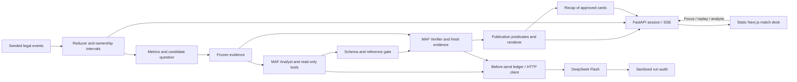

# MatchLens AI: Architecture

R0.1, 2026-10-19 PT. Stable stack: Microsoft Agent Framework + DeepSeek Flash, Python/FastAPI, Next.js/TypeScript. [SPEC](SPEC.md) owns contracts; [TECH_SPIKE](TECH_SPIKE.md) retains historical tests; [R0.1_REVIEW](R0.1_REVIEW.md) explains scope decisions.

## One deployable unit

One FastAPI process, one Uvicorn worker/replica owns sessions, clocks, evidence, task cancellation and inference semaphore. Next static export is served by FastAPI; Node is build-only. Development can use Next's `/api` proxy. API routes precede static fallback. No Foundry, Copilot CLI, proxy gateway, generic provider layer or third agent.

| Actual file | Responsibility |
| --- | --- |
| `services/api/matchlens/football.py` | Frozen events, controlled generator, reducer, intervals, metrics, candidates/snapshots |
| `contracts.py` | Claim/review schemas, core predicates, numeric slots and gate |
| `agents.py` | Real MAF graph, agents/tools, JSON parsing and HTTP instrumentation |
| `budget.py` | Persistent SQLite reservation ledger, separate from match state |
| `main.py` | Lifespan, sessions, controls/Focus epochs, SSE, concurrency, local run receipts/static UI |
| `apps/web/app/page.tsx` | Match desk, pitch, comparisons, modes, evidence/trace/overlay/recap |
| `scripts/live_validation.py` | Actual HTTP integration path with retained results |

This replaces a broad empty-folder plan. Add abstractions only for a demonstrated consumer.

## Collaboration and publication

Analyst chooses interpretation and audience wording; Verifier independently checks meaning, scope, counterevidence and uncertainty. Arithmetic, detection, freezing, gates and rendering are ordinary code. Each run/role has fresh context. `WorkflowBuilder` connects two executors; parsed/ref-checked Analyst output crosses an explicit hashed handoff. Verifier must retrieve original evidence independently.

Tools: `get_evidence(snapshot_id)` returns Harbor receipts and selected original chains; `get_event_chain(event_ids)` expands at most 20 in-prefix events. Snapshot scope is server-bound; no mutation, future expansion, web/shell/file tools or public prompt input.

Flash options: `json_object`, thinking explicitly disabled, `max_tokens=1024`, SDK retries zero. Strict native schema failed in the Spike; use local validation. Product runs led to a flat one-claim wire schema mapped into canonical variants. One bounded format correction per role uses the same session/evidence and cannot change claim/assertion/scope; all calls count toward the six-request cap. Version prompts and retain initial/corrected outputs. No code-based factual repair, agent debate or Pro retry.

Gate: schema/refs/identity → complete review + both tool receipt roundtrips + handoff → true core + valid selected scope/variant → bound prose. `qualify` cannot launder a false core through a disclaimer. UI renders evidence-bound summaries for accepted typed assertions; raw selected role prose and rationale stay in local operator records. Facts are rendered by `bound-facts-v1`, not silently rewritten in the model receipt.

## Data availability and publication boundary

The catalog separates three states: **CATALOGUED** (committed metadata, no
payload), **MATERIALIZED** (payload present but not verified for analysis) and
**ANALYSIS_READY** (import receipt + completeness + provider mapping, with the
content hash re-checked on load). A catalogued match stays visible with its
analysis action disabled; a missing payload is never replaced by synthetic data.
Partial imports merge into the manifest by match id instead of replacing it, and
paths are repo-relative POSIX so a Windows-authored manifest resolves on Linux.

Provider payloads are protected data. Anonymous responses contain aggregate
metrics, charts, bounded replay windows and bounded evidence references. The
complete normalized event stream requires the independently verified
producer/admin token; `limit`/`offset` cannot turn the public projection into a
payload export. Published analysis carries the StatsBomb licence and attribution.

## Private ownership

Investigations and agent-run records bind to the server-generated session that
created them. Reads, lists, cancellation and promotion all check that owner;
non-owners receive 404 so an ID probe cannot distinguish private from absent.
Legacy records without an owner are fail-closed to the producer role. Promotion
still writes a public registry claim, but only the draft owner or an independent
producer may trigger it. The match-detail projection includes private
investigations only for their owner, never for another anonymous session.

## State and time

Immutable event tuple is generated/validated at startup. Reducer recomputes current prefix; browser does not advance score itself. Session owns clock, pause/speed, epoch/revision, Focus, snapshots and local completed-result cache. Evidence is a canonical string, copies returned to tools. Workflow binds run ID, snapshot and epoch. SQLite budget persists across restarts; session state does not.

The match clock distinguishes `nominal_duration` (90/120 minutes), `observed_end`
(last recorded event), and `replayable_end` (the last addressable clock). Recorded
stoppage and extra time are replayable; unobserved time is not invented. Period
rows expose observed spans and stoppage; a shoot-out is reported as recorded
kicks, never as extra playing minutes. Snapshots created at the nominal clock
keep their historical canonical identity, while snapshots beyond it carry the
replayable clock explicitly.

## Performance

OAAI aggregates by mapping wall clock to effective play time and folding events
once (O(events + samples)); it no longer rescans every causal event at every
two-second sample. The real 4,691-event reference match improved from ~15s to
~0.3s cold / <10ms warm for the full timeline, with an exact regression oracle
against the old fold. Snapshots and OAAI results use bounded LRUs keyed by
dataset revision, clock version, metric version and as-of; a bounded replay cache
keeps hot seeks at ~10-15ms instead of ~0.6s cold. `scripts/benchmark_real_match.py`
enforces the real-match thresholds and numerical invariants in CI.

Focus seeks one of three cutoffs or an already detected moment and pauses. Pending analysis names that fixed as-of time. Exit/restart/chapter change increments epoch, cancels work and checks epoch again before commit. Even a cancellation-resistant late result cannot enter a new view. Reuse retains original run/as-of; historical recap cards resolve their own snapshot and score.

SSE: full state on revision changes, 10s comment heartbeat. Reconnect replaces old stream and resynchronizes; no cursor buffer. Eight active sessions, 30-minute idle expiry. Process restart requires reload; no false durable-resume claim. Arbitrary seek, shared model cache and workflow checkpoints are deferred.

## Bounds and cost

- One active workflow/session; two executing process-wide. Queue <=5s, workflow <=25s. Opt-in automatic inference during replay; at most two auto runs/session, one active run/session, four detector families and a 30-match-second cooldown. Six-request whole-run runway is checked before scheduling; each HTTP dispatch still reserves independently.
- At most three requests/agent, **six/run**; normal tool-using pair uses four. No automatic SDK retry. Failed/cancelled dispatches are not refunded.
- Fixed official HTTPS endpoint/model, <=48,000-byte JSON request body, <=1,024 output tokens, thinking disabled; enforced before send.
- SQLite `BEGIN IMMEDIATE` reserves **$0.02/request** before dispatch. Default global caps: **32 requests and $1 reserved**, whichever binds first. Ledger distinguishes dispatch, HTTP receipt and known usage.
- Peak Flash rates checked Oct 19: miss $0.30/M, hit $0.006/M, output $1.20/M. Conservative 48k input-token bound plus output is <$0.02. Revisit profile when pricing/model changes. Reservation is not an invoice or hosting-spend control.
- Eight workflows/session; analysis 3/min/session, 6/min/IP, 12/min/global; session creation 10/min/IP, 30/min/global; eight-session capacity. Bound control/stream requests and limiter memory. Duplicate active/completed Focus requests reuse a run; failures can retry within limits.

Six-request worst reservation $0.12/run, eight runs $0.96; actual costs measured separately. Judging needs an operator-funded daily/total allowance and hosting through Nov 10. Restore counters only as an explicit budget decision. One replica and persistent budget volume are required; do not trust arbitrary forwarded-IP headers.

## Failure and observability

| Failure | Behavior |
| --- | --- |
| Invalid fixture | Startup rejects; no inference |
| Malformed/schema/ref/slot/unsupported core | No invalid card; rejection or explicit statistics-only fallback |
| Verifier withholds | Public reason + facts; no proposed interpretation |
| Missing key/auth/provider error/timeout | Deterministic fallback; no blind retry; config repair or later bounded healthy run |
| Budget/concurrency exceeded | Block extra dispatch or bounded queue; evidence remains usable |
| Focus changes | Cancel, epoch-isolate and retain sanitized operator record |
| SSE failure | Reconnect full state; preserve visible content/connection status; polling/public-host probe next |
| Restart | In-memory sessions are gone (401); the client bootstraps a new session. Budget/claims survive if the volume persists. |

HTTP hooks record dispatch IDs/body bounds, status, returned model/usage and actual tool-result receipt hashes. Local files retain snapshot, raw role outputs, validated draft/handoff, review, selected cards and errors. No secret/headers/internal reasoning. Public trace shows stage/tool/request summaries. OpenTelemetry export is P1.

## Deployment gate

Build static UI/container; configure server secret, persistent budget, one worker/replica and explicit quotas. Test **from deployed host**: actual DeepSeek call, ten-minute stream/reconnect, control latency, cookie/origin boundaries and fresh judge path. Local success cannot establish this. Public host/funding/URL remain release work; README provides local reproduction.

R0.2 history loader recomputes the exact frozen prefix and reruns current publication gates. Mismatched hashes, missing audit, invalid prose or unsupported cores are excluded. Only the exact matching snapshot is registered; a new hash can never be stored under an old ID. Candidate snapshots stop at detection time, including the goal at 11:30. The UI uses snapshot receipts for analytical comparisons and the current prefix for the scoreboard. Native HTML dialog owns focus trapping/Escape/return focus. SSE has a two-second polling fallback; session expiry stops retries and offers a fresh replay.
