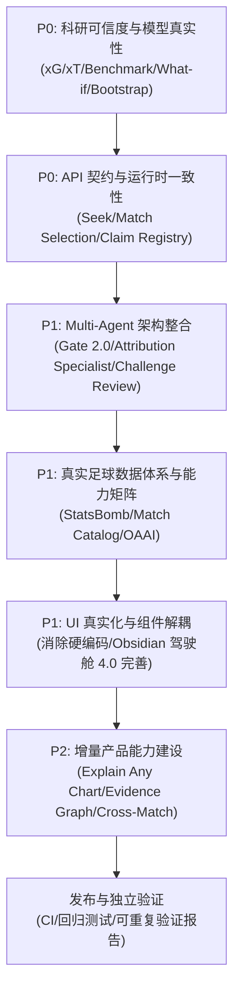

# MatchLens AI — 全系统代码与产品能力对账审计报告 (Code-to-Claim Audit)

**审计基准提交**：`ff584cc`  
**审计完成时间**：2026-10-22  
**审计范围**：后端架构、前端工作台、测试套件、算法模型、多智能体工作流、足球数据适配器及文档体系。  
**执行角色**：Principal Software Architect & Lead Quality Engineer

---

## 1. 总体对账结论与能力状态矩阵

通过对仓库最新 HEAD 的逐行代码级审查，MatchLens 已经具备了扎实的足球领域事件规约、双向中英本地化界面（Obsidian Tactical 四工作台架构）、确定性证据冻结（SHA-256 证据快照）和基础双智能体（Analyst + Verifier）执行管线。

但系统仍存在**显著的代码与宣传脱节、启发式公式冒充已训练模型、模拟数据冒充对照实验、以及硬编码叙事冒充生成式故事**等关键缺陷。

### 1.1 全系统能力状态总表 (Capability Audit Matrix)

| 核心模块 / 能力声明 | 当前实际实现状态 | 代码真实定位 | 缺陷与风险分析 | 审计分类 |
| :--- | :--- | :--- | :--- | :--- |
| **R0.2 核心双智能体管线** | Implemented & Verified | `services/api/matchlens/agents.py:100-265` | Analyst + Verifier 双智能体运行真实 MAF 图，严格执行 DeepSeek 预算账本与超时熔断。 | **Implemented & Verified** |
| **第三智能体 (Event Attribution Specialist)** | Implemented but Not Integrated | `services/api/matchlens/attribution.py`, `agents.py:252` | 仅以独立确定性工具类存在；并未接入 MAF Workflow 执行图，MAF 图仅运行 Analyst 与 Verifier 两个 Stage。前端和文档宣称“Tri-Agent Pipeline”名不副实。 | **Partially Implemented** |
| **Gate 2.0 发布门禁** | Implemented but Not Integrated | `services/api/matchlens/gate.py`, `agents.py:259` | `agents.py` 主链路实际调用的是 Gate 1.0 (`publication_gate`)；Gate 2.0 独立存在。且 Gate 2.0 中存在后缀匹配碰撞（`endswith`）和指标子串模糊匹配漏洞。 | **Partially Implemented** |
| **Interactive Challenge (质询复核)** | Demonstration / Heuristic Only | `services/api/matchlens/contracts.py:470-545`, `main.py:548-575` | `resolve_challenge` 根据 `challenge_type` 返回预设固定的 Maintained / Narrowed 文案；若找不到快照则悄悄伪造当前时间快照替代；缺少 Claim Registry 校验。 | **Defective** |
| **Hypothesis Lab (假设检验实验室)** | Partially Implemented | `services/api/matchlens/contracts.py:400-460`, `StoryAgentWorkbench.tsx:532-550` | 后端具有基于统计指标的候选规则生成，但前端界面内嵌了硬编码的假设文本（如 Harbor 3人逼抢、N4非受迫失误），未动态绑定后端矩阵。 | **Partially Implemented** |
| **Ask the Match (交互式战术问答)** | Demonstration / Heuristic Only | `services/api/matchlens/contracts.py:599-665` | 目前仅支持 3 个固定 `intent_id` 分支，不支持自然语言解析或灵活参数选择，属于受限意图选择器。 | **Demonstration / Heuristic Only** |
| **What-if Counterfactual Sandbox** | Experimental / Unvalidated | `services/api/matchlens/whatif.py:350-374` | 95% 置信区间由启发式误差公式构造（`1.96 * se`，其中 `se = max(0.015, abs(delta_amp)*0.18 + abs(delta_threat)*0.12)`），无经验校准；扰动事件未校验球权连续性。 | **Experimental / Unvalidated** |
| **Multi-Agent Benchmark (A/B/C 对照实验)** | Defective | `services/api/matchlens/validation.py:480-534`, `benchmark.py` | 准确率、拦截率、延迟和成本直接由包含 `turnover_density` 的线性预设公式计算（如 `acc_c = 0.94 - 0.02 * turnover_density`），而非真实运行实验结果。 | **Defective** |
| **xG 预期进球模型** | Defective (Outcome Leakage) | `services/api/matchlens/validation.py:92-93`, `whatif.py:72-73` | 当事件 `outcome == "goal"` 时，强制赋值 `xg = 0.75`，存在严重的赛后结果标签泄露（Outcome Leakage），非纯 Pre-shot 模型。 | **Defective** |
| **xT 预期威胁模型** | Heuristic Surface (Misattributed) | `services/api/matchlens/models/xt.py:171-255` | 默认网格通过解析几何指数衰减公式生成，但元数据声称通过 StatsBomb 500+ 赛事拟合；模块 import 时存在自动覆写模型文件的副作用。 | **Defective** |
| **Bootstrap & 跨赛事泛化评测** | Defective (Hardcoded Fallback) | `services/api/matchlens/validation.py:366-368` | 跨赛事评测异常时，默认退回至固定常量（MAE=0.038, RMSE=0.052, r=0.924），伪造科研结论。 | **Defective** |
| **全局时间跳转 (Seek Control)** | Defective | `apps/web/app/components/TacticalHeader.tsx:125`, `services/api/matchlens/main.py:128,450` | 前端发送 `action: "seek"`，后端 `Control.action` 枚举未包含 `"seek"`，导致拖拽时间轴触发 HTTP 422 报错。 | **Defective** |
| **赛事选择协议 (Match Selection Protocol)** | Defective | `apps/web/app/components/MatchStage.tsx:180`, `services/api/matchlens/main.py:474` | 前端尝试切换 `sb_wc2022_final` 时发送 `action: "set_scenario"`，后端严格校验 `SCENARIOS` 字典，导致真实赛事切换失败报 422。 | **Defective** |
| **Match Story & 比赛战报生成** | Demonstration / Heuristic Only | `services/api/matchlens/stories.py:99-106`, `StoryAgentWorkbench.tsx:76-96` | `stories.py` 强制将任何比赛（包括 12 分钟合成赛）时间扩展至 5400s 并固定为 0-30/30-60/60-90 章节；前端内嵌了硬编码的事件 ID 和叙事模板。 | **Demonstration / Heuristic Only** |
| **StatsBomb 真实赛事适配器** | Incomplete Coverage | `services/api/matchlens/adapters/statsbomb.py`, `data/matches/sb_wc2022_final.json` | 内置的 2022 世界杯决赛样本仅包含 12 个事件（6KB），属于极简测试夹具，不能支撑全场统计或 90 分钟战术复盘。 | **Partially Implemented** |
| **Obsidian Tactical 四工作区 UI** | Implemented & Verified | `apps/web/app/components/cockpit/*`, `page.tsx` | 比赛中心、战术实验室、叙事工坊、验证实验室四大工作区完整呈现，布局清晰，交互响应迅速。 | **Implemented & Verified** |
| **全站中英双语国际化 (i18n)** | Implemented & Verified | `apps/web/app/lib/i18n.ts`, 所有 UI 组件 | 实现了覆盖全部 4 工作区、5 种球场图层、抽屉与指标的中英对齐字典与实时切换。 | **Implemented & Verified** |

---

## 2. 核心代码缺陷与实证分析 (Defect Inventory)

### 缺陷 1：A/B/C Multi-Agent Benchmark 预设公式冒充实测
- **代码位置**：`services/api/matchlens/validation.py:481-534`
- **实证**：
  ```python
  block_a = round(0.32 + 0.08 * turnover_density, 3)
  acc_a = round(0.78 - 0.05 * turnover_density, 3)
  block_c = round(0.09 + 0.03 * turnover_density, 3)
  acc_c = round(0.94 - 0.02 * turnover_density, 3)
  lat_c = round(950.0 + 60.0 * (rnd.random() - 0.5), 1)
  ```
- **性质**：重大科研可信度缺陷。通过写死 `acc_c > acc_b > acc_a`，人为构造“第三智能体带来精度提升”的假象，未实际执行对照实验。
- **整改方案**：将基准严格解耦为 Deterministic Contract Benchmark（针对规则与门禁的确定性校验）与 Real Agent Comparative Evaluation（真实调用模型，记录实际 token、请求数、耗时、Gate 前后拦截率，未运行时显示 "Not Run"）。

### 缺陷 2：xG 计算中的赛后结果标签泄露 (Outcome Leakage)
- **代码位置**：`services/api/matchlens/validation.py:91-94`, `services/api/matchlens/whatif.py:71-74`
- **实证**：
  ```python
  act = _extract_action(ev)
  if "shot" in act:
      if str(_get_field(ev, "outcome", "")).lower() == "goal":
          return 0.75
  ```
- **性质**：严重数据科学错误。进球事件在射门前并不能知道是否进球，强制将进球赋值 0.75 造成目标变量泄露到特征中，彻底推翻 xG 模型作为“独立机会质量评估”的有效性。
- **整改方案**：纯 pre-shot 特征计算（基于射门坐标、距离、角度）。标记来源为 `heuristic_shot_danger`，在未经过校准前严禁冠以 `calibrated_xg`。

### 缺陷 3：xT 模型来源元数据与实际生成方式严重脱节
- **代码位置**：`services/api/matchlens/models/xt.py:200-254`
- **实证**：网格是 `base_threat = 0.002 + 0.08 * (x_norm ** 2.4)` 纯数学公式生成，但元数据写着：
  ```python
  "training_corpus": {
      "provider": "StatsBomb Open Data Baseline Benchmark",
      "competitions": ["FIFA World Cup 2022", "UEFA Euro 2020"]
  }
  ```
  且模块被引用时通过 `save_default_grids()` 自动覆写磁盘文件。
- **性质**：数据来源不真实，存在副作用文件写入。
- **整改方案**：严格定义 `Heuristic Threat Surface` 与 `Empirically Fitted xT`。默认网格元数据如实标注为基于 Karun Singh 空间先验的人工几何曲面；删除 import 时的自动写盘副作用；显式加载只读静态模型。

### 缺陷 4：What-if 沙盒虚构 95% 置信区间
- **代码位置**：`services/api/matchlens/whatif.py:351-353`
- **实证**：
  ```python
  se = max(0.015, abs(delta_amp) * 0.18 + abs(delta_threat) * 0.12)
  ci_low = round(delta_amp - 1.96 * se, 3)
  ci_high = round(delta_amp + 1.96 * se, 3)
  ```
- **性质**：将经验加权系数乘 1.96 伪造成高斯分布下的 95% 置信区间（95% CI）。
- **整改方案**：划分为明确的人工扰动敏感性分析（Descriptive Transformation / Sensitivity Analysis）。在未进行真实重采样或概率建模前，严禁标称为 95% CI。

### 缺陷 5：跨赛事泛化评测硬编码失败兜底
- **代码位置**：`services/api/matchlens/validation.py:366-368`
- **实证**：
  ```python
  cross_mae = gen_report.cross_match_mae if gen_report else 0.038
  cross_rmse = gen_report.cross_match_rmse if gen_report else 0.052
  cross_r = gen_report.cross_match_pearson_r if gen_report else 0.924
  ```
- **性质**：当评测失败或无跨场数据时，伪造极其优异的拟合指标（r=0.924）。
- **整改方案**：计算失败时显式返回 `status: "failed"` 或 `None`，UI 展示“未计算/样本不足”，坚决不使用伪造数值。

### 缺陷 6：全局 Seek 时间拖拽崩溃 (HTTP 422)
- **代码位置**：`apps/web/app/components/TacticalHeader.tsx:125`, `services/api/matchlens/main.py:128,450`
- **实证**：前端发送 `{ action: "seek", at: 350 }`，后端 `Control` 模型仅允许 `Literal["focus", "focus_moment", ...]`，缺少 `"seek"` 及 `at` 字段。
- **性质**：核心高频交互通道阻断。
- **整改方案**：后端 `Control` 模型增加 `action: "seek"`, `at: Optional[int]`；并在 `main.py` 的 control 处理中支持瞬时时间跳转与锚点更新，自动同步已观测事件边界。

### 缺陷 7：赛事切换协议与数据隔离缺失
- **代码位置**：`apps/web/app/components/MatchStage.tsx:180`, `services/api/matchlens/main.py:474`
- **实证**：前端尝试加载 StatsBomb 赛事时提交 `action: "set_scenario", scenario: "sb_wc2022_final"`，后端只从 `SCENARIOS` 查找，导致真实赛事切换失败报 422；且不同赛事的快照、队伍名称存在跨会话污染风险。
- **整改方案**：建立统一 Match Selection Protocol，区分 `synthetic` 与 `catalog`；重置赛事上下文，按赛事类型动态决定时间轴长度与支持功能。

### 缺陷 8：Gate 2.0 引用核验的字符串匹配漏洞
- **代码位置**：`services/api/matchlens/gate.py:214, 223`
- **实证**：
  `any(k.endswith(f"-{eid}") for k in known_event_ids)`（若 eid 为 1，会错误匹配到 `-1` 结尾的所有事件）；
  `any(m in mid for m in valid_metrics)`（子串匹配，若 catalog 有 `"xG"`，任意带有 `"xG"` 的字符串都被视为合法）。
- **性质**：门禁安全绕过漏洞。
- **整改方案**：必须全字匹配或规范前缀命名空间校验，严禁后缀与子串模糊命中。

### 缺陷 9：第三智能体 (Specialist) 并未进入实际 MAF 工作流
- **代码位置**：`services/api/matchlens/agents.py:252`
- **实证**：
  ```python
  analyst, verifier = Stage("Analyst"), Stage("Verifier")
  workflow = WorkflowBuilder(start_executor=analyst).add_edge(analyst, verifier).build()
  ```
- **性质**：架构与宣传不符。当前只有双智能体（Analyst -> Verifier），第三智能体仅作为前端概念或独立计算模块展示。
- **整改方案**：
  方案一：架构降级实事求是，前端与文档改称“Dual-Agent + Deterministic Attribution Engine”；
  方案二：真正将 Event Attribution Specialist 包装为 MAF Stage，拥有独立的 prompt、输入输出 schema 与工具集，形成 Analyst -> Specialist -> Verifier 的可执行三阶段图。

### 缺陷 10：测试用例包含本地绝对路径及纯字符串检查
- **代码位置**：`services/api/tests/test_challenger2_verification.py:11`
- **实证**：`REPORT_PATH = Path(r"d:\Projects\match-lens\.agents\teamwork\orchestrator_1\FOOTBALL_INTELLIGENCE_PLATFORMS_2026.md")`
- **性质**：非便携测试，在 CI 环境或其他系统必挂；以文档中是否存在某中文词汇充当算法校验。
- **整改方案**：消除绝对路径，分离文档一致性测试与核心逻辑测试。

---

## 3. 架构依赖与整改优先级 (Phased Priorities)



- **P0（立即执行，阻塞性）**：
  1. 修复 xG 结果泄露，建立可信的 pre-shot 计算与元数据标定。
  2. 修复 xT 网格元数据与导入副作用，区分人工几何曲面与经验拟合曲面。
  3. 重构 Multi-Agent Benchmark，废除固定公式，建立确定性基准与真实实验追踪。
  4. 修复 What-if 虚构 95% CI，改为明确的敏感性扰动分析。
  5. 修复 Seek 控制与 Match Selection API 报错。
  6. 修复 Gate 2.0 模糊匹配与 Claim / Snapshot 篡改问题。

- **P1（系统性重构）**：
  1. 统一 Agent 工作流，将 Specialist 真正接入 MAF 执行图或明确重标为双智能体+确定性工具。
  2. 建立统一 Claim Registry 与真实的因果/样本质询复核流程。
  3. 改造 Story 引擎，动态适配真实比赛时长与事件流，删除硬编码叙事。
  4. 区分 StatsBomb 局部夹具与全场比赛，建立数据质量与能力矩阵。
  5. 拆分前端超大组件，全面绑定后端动态数据。

- **P2（增量产品力）**：
  1. Explain Any Chart（点击图表下钻结构化问答）。
  2. Evidence Graph（全链路证据图谱可视化）。
  3. Cross-Match 多赛事对比分析。
  4. 自动化 CI 工作流构建。

---

本审计报告已建立全系统准确事实底表，作为后续所有重构提交的唯一对账准绳。
