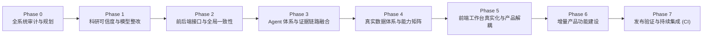

# MatchLens AI — 全系统整改与增量演进路线图 (Implementation Roadmap)

**版本**：v2.0-Production-Ready  
**目标**：将 MatchLens 从“功能丰富但存在模拟结果、规则演示与真实 Agent 执行混杂的足球智能工作台”，升级为“数据来源清楚、数学定义可信、Agent 协作真实、交互链路完整、UI 成熟且可以继续扩展的 Football Intelligence Platform”。

---

## 阶段演进总览 (Phase Overview)

---

## 阶段细化任务与验收标准

### Phase 0: 审计与规划对账 (Audit & Reconciliation) — [已完成]
- [x] 读取最新 HEAD (`ff584cc`)，完成代码与声明逐项对账。
- [x] 输出完整对账报告 `docs/FULL_SYSTEM_AUDIT.md`。
- [x] 建立阶段依赖与整改技术规格。

---

### Phase 1: 科研可信度与事实正确性整改 (Correctness & Integrity)
**目标**：彻底消除预设公式冒充实测、数据标签泄露、以及伪造置信区间的学术不端隐患。

1. **xG 计算模型重构 (`oaai.py`, `validation.py`, `whatif.py`, `schema.py`)**：
   - 彻底移除 `if outcome == "goal": return 0.75` 赛后结果泄露。
   - 建立纯 Pre-shot 启发式与统计特征计算（仅允许射门瞬间的坐标、距离、角度）。
   - 建立明确的指标元数据：`xg_model_version`, `xg_source` ("heuristic_pre_shot" vs "fitted_logistic"), `calibration_status` ("uncalibrated_heuristic" vs "calibrated").
   - 严格禁止在未校准前打上 `calibrated_xg` 标签。
2. **xT 威胁网格来源与元数据修正 (`models/xt.py`, `data/models/*.json`)**：
   - 将模型分为 `Heuristic Threat Surface` 与 `Empirically Fitted xT`。
   - 修正默认网格元数据：如实注明为基于 Karun Singh 解析空间公式生成的启发式曲面，严禁冒充经过 StatsBomb 赛事训练拟合。
   - 移除模块导入时的 `save_default_grids()` 自动写盘副作用，改为纯只读静态加载或显式构建命令。
3. **What-if 沙盒数学约束 (`whatif.py`)**：
   - 区分三层能力：Descriptive Transformation（数学重算）、Assumption-driven Scenario Analysis（用户显式假设分析）、Statistical Counterfactual Research（统计反事实研究，当前标记 Experimental）。
   - 废除启发式加权乘 1.96 伪造的 95% CI，改为明确的敏感性扰动带（Sensitivity Spread），并附带科学免责声明。
   - 严禁将 xT 差值直接换算为赢球概率。
4. **Multi-Agent Benchmark 解耦 (`validation.py`, `benchmark.py`)**：
   - 建立 Deterministic Contract Benchmark（针对规约、门禁、事件ID校验的确定性用例）。
   - 建立 Real Agent Comparative Evaluation 架构：仅当真正执行大模型时记录实际 Token、请求数、耗时与实测准确率；未执行时明确标记状态为 `Not Run`，严禁使用预设线性公式计算指标。
5. **Bootstrap 与跨赛事验证鲁棒性 (`validation.py`)**：
   - 跨赛事泛化失败时返回 `Not Computed / Failed`，移除写死的 `0.038 / 0.052 / 0.924` 常量兜底。
   - 明确标注样本量与统计方法局限性。

**阶段验收标准**：
- 任何界面或接口输出的定量指标都有明确数学公式或模型文件追溯。
- 进球与未进球但相同坐标的射门具有完全一致的 Pre-shot xG。
- 单元测试与回归测试 100% 通过。

---

### Phase 2: 运行时一致性与前后端接口整改 (Runtime & API Consistency)
**目标**：消除全局交互通道断裂与多赛事上下文污染。

1. **全局时间跳转 (Seek Control) 实现 (`main.py`, `TacticalHeader.tsx`)**：
   - 在后端 `Control` 模型中添加 `action: "seek"`, `at: Optional[int]`。
   - 在 `main.py` 的 control 处理器中支持瞬时时间跳转，校验 `[0, duration_seconds]` 边界，刷新时间锚点，更新已观测事件游标。
   - 前端时间轴增加防抖/节流（Throttled Seek），拖动释放后提交最终值。
2. **统一赛事选择协议 (Match Selection Protocol) (`main.py`, `catalog.py`, `MatchStage.tsx`)**：
   - 区分合成赛事与 Catalog 真实赛事，支持 `action: "set_match", match_id: str`。
   - 赛事切换时彻底隔离并重置 Session 状态（清空不匹配的历史快照、事件游标、焦点）。
   - 动态识别赛事时长（12 分钟合成赛 vs 90 分钟全场赛），统一各工作区时钟与主客队名称。
3. **前后端接口规范与错误码对齐**：
   - 补全所有核心接口的 Pydantic 模型与 OpenAPI 规范。

**阶段验收标准**：
- 拖拽时间轴能够平滑跳转至任意时刻，无 422 报错，事件与球场视图即时同步。
- 自由切换合成赛事与真实比赛，四大工作台数据与时钟完全匹配。

---

### Phase 3: Agent 体系与证据链路融合 (Agent & Evidence Integration)
**目标**：统一 Claim、Gate 与证据质询，确保模型推理与事实门禁严丝合缝。

1. **统一 Claim Registry (`contracts.py`, `main.py`)**：
   - 建立会话内与持久化 Claim 索引，每个发布的 Claim 必须绑定 `claim_id`, `snapshot_id`, `as_of`, `claim_level`, `evidence_refs`, `publication_gate_version`。
   - 严禁对不存在或跨 Snapshot 的 Claim 发起 Challenge；严禁因快照缺失而暗中构造当前时刻快照替代。
2. **重构 Challenge 复核流程 (`contracts.py`)**：
   - 废除根据 `challenge_type` 返回写死文案的逻辑。
   - 真实提取 Claim 引用的事件链和指标数据，对因果性、反证、样本窗口进行实证核查。
   - 若证据不足则返回 `Inconclusive`；若因果断言被事实推翻则生成 `Narrowed` 或 `Withdrawn` 的正式修订记录。
3. **Revision Timeline 幂等性与版本链 (`main.py`, `contracts.py`)**：
   - 支持结构化版本链（Parent Claim -> Challenge -> Revision），具备请求幂等防重试保护。
4. **Gate 1.0 与 Gate 2.0 深度融合 (`gate.py`, `agents.py`)**：
   - 修复 Gate 2.0 中的 `endswith` 后缀模糊碰撞与指标子串匹配漏洞，升级为全字严格匹配。
   - 将 Gate 2.0 作为主线发布门禁（或通过统一门禁入口深度集成），确保所有面向观众的 Claim 均经过可追溯核验。
5. **真实 Agent 架构实事求是**：
   - 明确标注当前主线 MAF 工作流为 Analyst 与 Verifier 双智能体；若引入 Event Attribution Specialist，则将其作为独立的专用 MAF 执行阶段（拥有独立 prompt 与 schema），杜绝概念冒充。

**阶段验收标准**：
- Challenge 能针对具体 Claim 和实际事件给出精准复核结论。
- Gate 2.0 能够精准拦截伪造事件 ID 与伪造指标 ID，无字符串穿透漏洞。

---

### Phase 4: 真实足球数据体系与能力矩阵 (Football Data & Capability Matrix)
**目标**：建立专业足球数据契约，区分局部夹具与全场赛事。

1. **StatsBomb 适配器与数据分级 (`adapters/statsbomb.py`, `catalog.py`)**：
   - 明确标识 `sb_wc2022_final` 为 `Partial Test Fixture (C1_PARTIAL)`（12 事件），禁止对其生成全场 90 分钟定量结论。
   - 接入或生成具备完整半场/全场事件流的规范测试数据集，验证加时赛、点球大战与攻击方向转换逻辑。
2. **构建 Data Quality & Capability Matrix (`catalog.py`, `schema.py`)**：
   - 定义三维能力矩阵：数据覆盖度（On-ball, Lineups, 360）、衍生指标能力（xG, xT, OAAI, Sequence）、证据质量（校准状态、样本量、局限性）。
   - 当赛事数据不足时，在 UI 和 API 中显式展示具体缺失原因，严禁使用零值或虚构模板填充。
3. **OAAI 算法复审与时间单向性强化 (`oaai.py`)**：
   - 确保实时流分析中仅使用单侧因果平滑，双侧平滑仅标记为赛后离线分析。

**阶段验收标准**：
- 明确标注每个赛事的覆盖级别，数据不足时优雅降级并展示缺失说明。

---

### Phase 5: 前端工作台真实化与产品解耦 (Product UI & Studio)
**目标**：消除前端硬编码叙事，全面绑定后端动态数据，提升交互品质。

1. **消除硬编码叙事与模拟数据 (`StoryAgentWorkbench.tsx`, `MatchRecap.tsx`)**：
   - 移除写死的 `ev_h_carry_42` 等伪造事件，真实绑定当前比赛事件与 OAAI 时序分解。
   - 移除写死的假设 A/B 文本，动态读取后端 `hypotheses_matrix`。
   - 改造 Story 生成器，按实际比赛时长（12 分钟或 90 分钟）动态划分战术阶段。
2. **拆分超大组件与优化状态管理**：
   - 降低主界面中的密码学哈希（SHA-256）与底层指标代号权重，将其收纳于巡检抽屉（Inspector Drawer）与科研模式中，首屏优先呈现足球战术价值。
   - 优化响应式布局与触控体验。

**阶段验收标准**：
- 前端工作台全部文本与图表数据均来自后端 API，无任何写死假数据。
- 静态构建 (`npm run build`) 0 报错，全页面中英切换完备。

---

### Phase 6: 增量产品功能建设 (Net-New Capabilities)
**目标**：打造差异化的足球智能深度分析工具。

1. **Explain Any Chart (交互式图表解释器)**：
   - 用户点击 OAAI 峰值、射门点、传球网络或空间威胁单元格时，自动构造结构化查询上下文，并触发对齐证据的战术解释。
2. **Evidence Graph (全链路证据图谱)**：
   - 建立比赛 -> 序列 -> 事件 -> 指标 -> 假设 -> 论点 -> 质询 -> 修订的结构化图谱关系，并在抽屉中可交互追溯。
3. **Cross-Match Intelligence (跨场表现洞察)**：
   - 扩展 Match Catalog，展示同一球队跨多场赛事的战术通道偏好与稳定性分析。

**阶段验收标准**：
- 能够从任意图表元素一键跳转至原始底层事件与支撑论据。

---

### Phase 7: 发布验证与持续集成 (Release & CI)
**目标**：确保系统随时可构建、可复现、可交付。

1. **测试用例清理与便携化**：
   - 移除 `test_challenger2_verification.py` 中的绝对路径，分离文档一致性测试与业务代码测试。
   - 补充针对新修复特性的端到端契约测试。
2. **GitHub Actions CI 建设**：
   - 配置 Python 测试、TypeScript 类型检查、Next.js 构建流水线。
3. **撰写全套成果文档并同步旧文档**。

---

## 阶段提交规划 (Commit Discipline)
每个阶段完成独立验收后执行规范功能提交：
- `feat(scientific): remediate xG, xT, what-if, and benchmark scientific credibility`
- `feat(api-agents): seek control, match selection, claim registry, and gate integration`
- `feat(data): statsbomb fixture categorization, data capability matrix, and coverage checks`
- `feat(ui): eliminate hardcoded narratives, integrate real hypotheses, and fix seek/match switching`
- `feat(intelligence): explain-any-chart, evidence graph, CI workflow, and regression verification`
