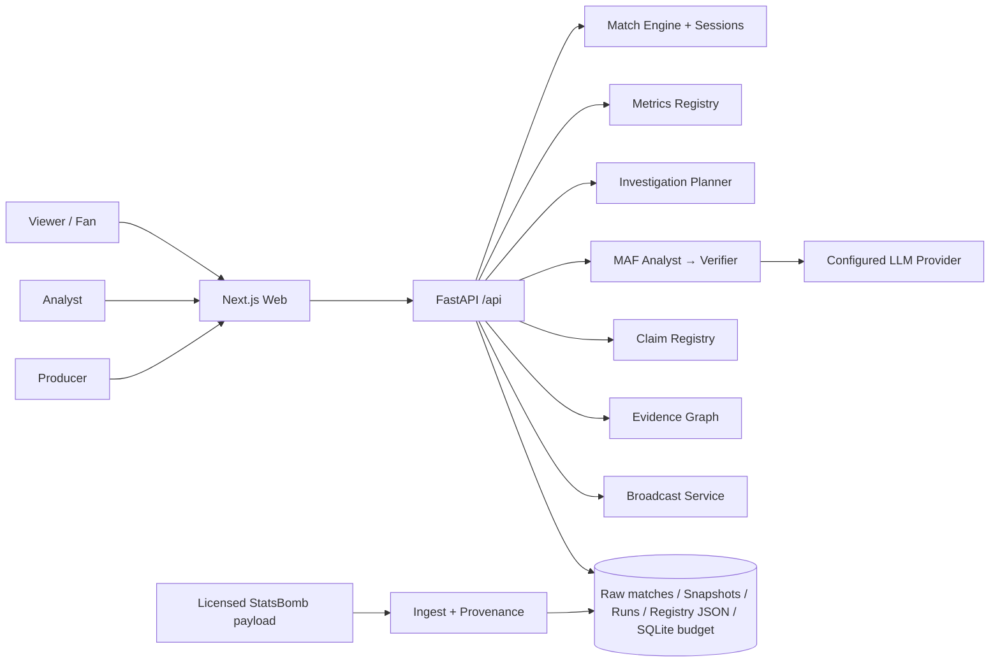
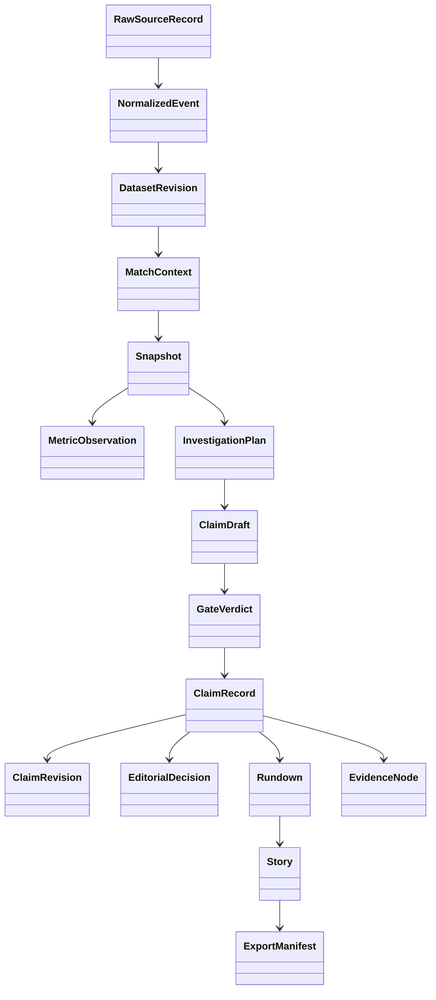
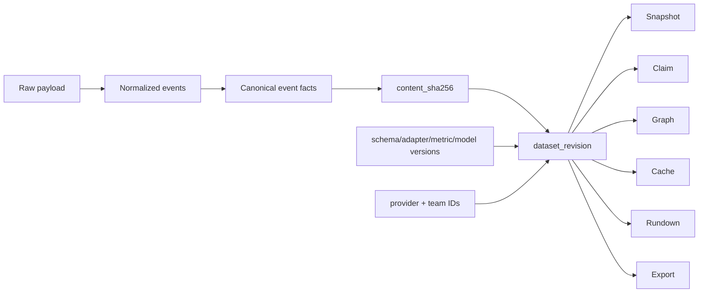
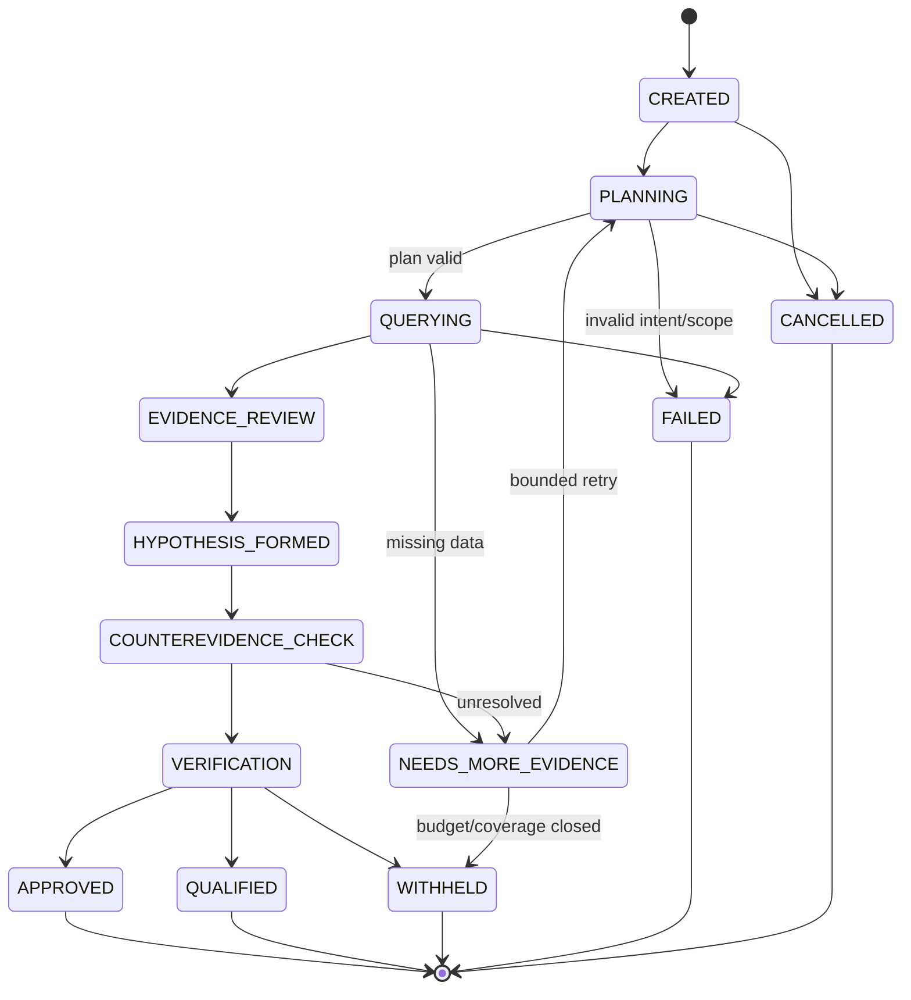
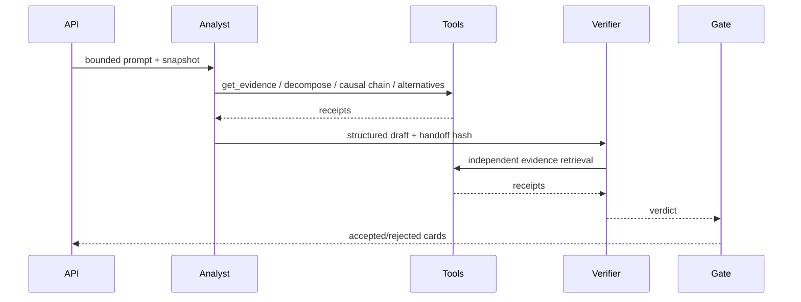
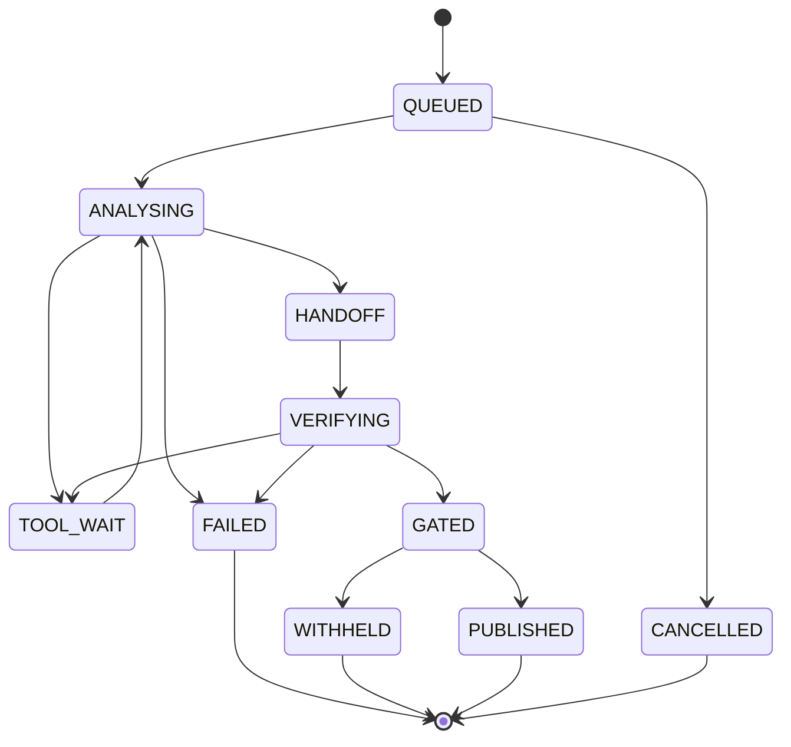
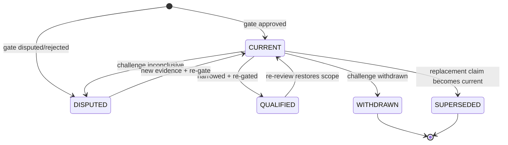

# MatchLens AI — Next-Generation Architecture V2

**Version**: 2.0
**Code baseline**: `9abe7e3` (verified at the time of writing)
**Status legend**: `[CURRENT]` implemented in code · `[TARGET]` design target ·
`[MIGRATION]` required transition · `[GAP]` known defect.

This document is a design contract, not a delivery claim. A capability is
`[CURRENT]` only when a real code path and an executed test exist. The
capability matrix in `CAPABILITY_STATUS.md` is the single status authority.

---

## 1. Architecture Principles

1. **One fact base.** Every chart, Ask answer, Agent tool, Story and export
   reads the same normalized event stream, DatasetRevision, Snapshot and
   Metric Registry. No second possession model or ad-hoc metric formula.
2. **Evidence before narrative.** A claim must bind event/metric receipt IDs.
   Narrative text is rendered from typed assertions, not treated as evidence.
3. **Unknown is not zero.** Missing coordinate, missing denominator, missing
   model and unobserved period have distinct statuses.
4. **Identity is explicit.** Provider team/player IDs are mapped by declaration,
   never by display-name substring. Claim identity is
   `(match_id, snapshot_id, claim_id)`.
5. **Approval is server-authorized.** Gate verification and editorial approval
   are different actions with different principals and different audit records.
6. **History is immutable.** A claim's current pointer may change; old revision
   payloads, statements and evidence scopes may not be rewritten.
7. **Bounded agency.** Agent/tool execution has fixed tools, budgets, deadlines
   and state transitions. No arbitrary SQL, Python or HTTP execution.
8. **Reversible publication.** Any published claim can be challenged, narrowed,
   withdrawn and re-reviewed without deleting its history.
9. **Product maturity is measured by user outcomes**, not by the number of
   tables, APIs or green tests.
10. **No external claim without provenance.** Event count, model quality and
    cross-match generalization require a receipt or remain Not Run.

---

## 2. System Context



**Runtime boundaries** `[CURRENT]`:

- Web is a static export behind the FastAPI process.
- One Uvicorn worker because the budget ledger and session state are
  single-writer.
- Provider credentials stay server-side.
- Runtime artifacts: `runs/*.json`, `claims.json`, `broadcast.json`,
  `budget.sqlite3`; no arbitrary user filesystem access.
- Agents only receive registered tools with snapshot-bound arguments.

---

## 3. Runtime Boundaries and Trust Zones

The matrix below is the **target** authorization contract. Current enforcement is
narrower: producer/admin token principals plus single-worker session isolation;
there is no account system or per-user draft ownership yet.

| Zone | Who | Can do | Cannot do |
| --- | --- | --- | --- |
| Public viewer | anonymous | read matches, charts, stories, evidence | approve, write registry, invoke arbitrary tools |
| Analyst | session user | replay, ask, challenge, run configured analysis | approve content, inspect other users' drafts |
| Producer | server token principal | editorial approve/reject, rundown, export | change facts or gate verdicts |
| Admin | server token principal | producer actions plus configuration | bypass gate checks |
| Agent | server process | call allow-listed tools with bounded args | SQL/Python/network/filesystem |
| Model provider | external | return prose under schema | write registry directly |

`[CURRENT]` token principals (`auth.py`) and single-worker session isolation.
`[TARGET]` account/SSO system with per-user draft, rundown and investigation
ownership. `[GAP]` public request paths and producer projections still share
some read endpoints.

---

## 4. Domain Model

The diagram is the **target** domain model, not a list of delivered classes.
`[CURRENT]` code implements normalized events, dataset revision, match context,
snapshot, on-demand metric values, investigation plan, claim draft/gate
verdict/claim record/revision, evidence nodes, rundown, story and an export
package. `RawSourceRecord` and `ExportManifest` are target artifacts.



### Core objects

| Object | Key fields | Invariant |
| --- | --- | --- |
| `RawSourceRecord` | provider, provider_event_id, license, schema_version | source lineage is retained |
| `NormalizedEvent` | canonical team/player IDs, period, clock, action, outcome, coordinates, provider possession | missing location stays null |
| `DatasetRevision` | content_sha256, schema/adapter/metric/model versions, coverage | changes whenever event facts change |
| `MatchContext` | match ID, provider, duration, observed_end, coordinate frame, coverage, official score | every API response is bound to it |
| `Snapshot` | as_of, event prefix, possession intervals, receipts, coverage, dataset revision | immutable; no future events |
| `MetricDefinition` | ID, formula, scope, unit, dependencies, missing policy, model status | definition, not a value |
| `MetricObservation` | definition ID + value/status/denominator/events/coverage | computation, not a definition |
| `InvestigationPlan` | intent, scope, tool receipts, hypotheses, gate preview | every tool call receipted |
| `ClaimRecord` | identity, lifecycle pointer, gate/editorial status, evidence hash | current state may change |
| `ClaimRevision` | parent, immutable payload, outcome, review | payload never rewritten |
| `EvidenceNode` | type, stable ID, source, dataset revision | no missing receipt as zero |

`[TARGET]` `MetricObservation` and `ExportManifest` are first-class stored
artifacts. `[CURRENT]` `MetricValue` is computed on demand and not persisted per
snapshot; export returns a package plus provenance fields, not a validated
manifest.

---

## 5. Match and Dataset Identity

### 5.1 Identity algebra

```text
match_key          = provider + provider_match_id + canonical_match_id
player_key         = provider + provider_player_id
team_key           = provider + provider_team_id
event_key          = provider + provider_event_id
snapshot_key       = SHA256(match_key, dataset_revision, as_of, reducer_version)
claim_key          = match_key + snapshot_key + claim_id
revision_key       = claim_key + version + payload_hash
```

`[CURRENT]` provider team IDs and canonical H/N team IDs; event and snapshot IDs;
claim record identity includes snapshot; revisions have IDs.
`[TARGET]` stable provider player/team registry for cross-match aggregation.
`[GAP]` cross-match `team_summaries` still uses display names as keys.

### 5.2 DatasetRevision



`[CURRENT]` content-addressed revision in `catalog.py`; snapshots and claims
carry it; caches use it.
`[MIGRATION]` enforce equality at every read boundary:
`claim.dataset_revision == snapshot.dataset_revision == rundown.dataset_revision`.
`[GAP]` Story/Export currently do not reject a claim with a mismatched dataset
revision at read time. Broadcast rundown checks at build time but not at read.

### 5.3 Snapshot identity

`[CURRENT]` snapshot ID is a content hash; `as_of`, event prefix, coverage and
as-of score are frozen. A route may not query beyond `MatchContext.duration`.
`[TARGET]` snapshot ID includes reducer and metric versions explicitly (they are
currently in the dataset revision but not printed as separate fields).

---

## 6. Data Coverage and Provenance

### 6.1 Coverage states

| State | Meaning | Allowed use |
| --- | --- | --- |
| `COMPLETE_VERIFIED` | source declaration + period/event coverage checks pass | full-match totals and per-90 |
| `COMPLETE_CLAIMED_UNVERIFIED` | provider says complete, no independent verification | labeled only |
| `PARTIAL_OBSERVED` | observed prefix with known gaps | prefix stats, no per-90/full totals |
| `SPARSE_SAMPLE_FIXTURE` | protocol/schema sample | UI/demo only |
| `INVALID_CORRUPTED` | schema, provider or integrity failure | rejected |

`[CURRENT]` `C0 / C1 / C1_PARTIAL` and observable/time coverage fields.
`[GAP]` `ingest.py` classifies completeness with
`observed_end >= format_seconds - 60`; a sparse payload containing only start
and final events can be mislabeled complete.

### 6.2 Dataset Completeness Verification `[TARGET]`

```text
source declaration
raw event count
normalized event count
conversion drop count + reasons
observed periods
event coverage by period
expected duration
known missing segments
provider consistency checks
integrity checks
completeness confidence
verification status
```

Acceptance requires period coverage, event-density sanity and provider
declarations, not merely a time span. A dataset cannot enter per-90 or
cross-match comparison until it is `COMPLETE_VERIFIED`.

### 6.3 Provenance

`[CURRENT]` `ingest.import_match` writes source/target SHA-256, license,
provider IDs, event count, observed end and coverage receipt; no hidden network
download. `[TARGET]` receipt also stores per-period coverage, drop reasons and a
verifier signature.

---

## 7. Metrics and Analytics Registry

### 7.1 Three separate concepts

- **MetricDefinition** — ID, formula, scope, unit, dependencies, missing policy,
  model status, version.
- **MetricComputation** — executable function with declared inputs and caching
  key.
- **MetricObservation** — the value for a specific snapshot/team/window/coverage,
  with numerator, denominator, evidence IDs and status.

`[CURRENT]` definitions + computation + value in `metrics.py`; API.
`[TARGET]` persisted observations and shared computation cache.

### 7.2 Semantic matrix

| Dimension | Values |
| --- | --- |
| team | H / N / both |
| window | previous / current / match / custom |
| coverage | verified complete / partial / unknown |
| value status | ok / unobserved / missing_input / not_applicable / not_calibrated / not_available |
| scope | team / player / match |
| model status | deterministic / heuristic / calibrated / not_calibrated / unavailable |

Rules:

- `goals` is a match-scoped fact. A windowed request must either compute goals
  inside that window or return `not_applicable` for the match label, never
  return a full-match receipt under a window label.
- `oaai` is a team model output; a query must apply the team sign and requested
  window, not return the global absolute peak.
- `possession` with a zero denominator is `unobserved`, not 0; an unknown
  coverage state is `unobserved`, never `0`.
- A provider field absent from the payload is `missing_input`; a field that does
  not apply to the event is `not_applicable`.
- Missing location excludes spatial terms but does not delete the event.
- xG with no calibrated model is `not_calibrated` (target; current API reports
  `not_available`), never a heuristic substitute.

### 7.3 Known defects `[GAP]`

1. `_receipt_key("goals", ...)` always returns `goals.match`, so a
   current/previous request is labeled `current/previous` but uses match data.
2. The `oaai` branch computes the full timeline and picks the global absolute
   peak; it ignores team and window.
3. Charts still call `exploration.py` / `oaai.py` directly in places, so
   Registry and chart definitions are not yet one service.
4. OAAI contribution events are not exposed as a recomputable ledger in
   MetricObservation.

### 7.4 Migration `[MIGRATION]`

1. Add a registry execution adapter for every chart query.
2. Fix goals/oaai window semantics and add matched tests.
3. Add a per-snapshot MetricObservation cache keyed by
   `(snapshot, metric, team, window, dataset_revision)`.
4. Add OAAI contribution ledger rows: event ID, weight, decay, zone, xG/xT term,
   total; expose through Explain/Investigation.
5. Remove duplicate chart calculations only after equivalence tests.

---

## 8. Investigation Engine

### 8.1 Target flow

```text
Question / Chart selection / Event / Player / Sequence / Zone
  → Intent classification
  → Scope (match, window, team, player, sequence)
  → Tool plan (only relevant metrics/tools)
  → Evidence retrieval
  → Candidate explanations
  → Counterevidence checks
  → Verification
  → Gate preview
  → Optional user-confirmed Claim
  → Challenge / Revision
```

### 8.2 Intent and scope

`[TARGET]` A typed intent enum:

`WHY_CHANGE`, `WHO_CONTRIBUTED`, `COMPARE_WINDOWS`, `FIND_COUNTEREVIDENCE`,
`CHECK_SAMPLE`, `EXPLAIN_SEQUENCE`, `COMPARE_MATCHES`, `UNKNOWN`.

- `UNKNOWN` must be rejected with a request for scope, not silently mapped to a
  generic six-metric report.
- An invalid Event/Sequence ID is an error, not a fallback to a generic moment.
- Moment and Sequence identities are separate types; possession ID cannot be
  accepted as a Moment ID.
- A chart selection carries `chart_type`, `snapshot_id`, `team`, `event/zone/
  edge/point` and optional time window directly into the plan.

### 8.3 Investigation state machine



Bounds: max tool calls, max wall time, max metric queries, max hypotheses; no
unbounded retry. Human intervention points: scope correction, additional data,
claim promotion, editorial approval.

`[CURRENT]` deterministic planner only; no explicit state persistence; the
question only affects the investigation ID, not plan selection. `[TARGET]` the
full state machine and chain.

### 8.4 Tool registry `[TARGET]`

| Tool | Inputs | Output | Cost guard |
| --- | --- | --- | --- |
| get_match_context | match | context/coverage | 1 |
| query_metric | metric, team, window | MetricObservation | 1 per metric |
| compare_windows | two windows | metric deltas | bounded |
| search_events | filters, limit | events | max 50 |
| get_possession_sequence | sequence ID | events/path | max 20 |
| get_player_actions | player, window | actions | max 50 |
| get_spatial_distribution | team, window | zones | 1 |
| get_attacking_channels | team, window | channels | 1 |
| explain_oaai_contributors | point/time/team | contribution ledger | 1 |
| find_counterevidence | assertion/refs | counterexamples | 1 |
| compare_matches | match list | coverage-aware metrics | bounded |
| check_data_sufficiency | question/scope | evidence gap | 1 |

Every tool returns `snapshot_id`, `dataset_revision`, `status`, evidence IDs and
a result hash. No arbitrary SQL/Python/HTTP.

### 8.5 Reasoning levels and evidence classes

The four-level framework in `AGENTS.md` is binding. The investigation engine may
not silently promote a claim to a stronger class.

| Level | Meaning | Required evidence | Allowed verification |
| --- | --- | --- | --- |
| L1 Observable fact | Event, coordinate, time, score, period | Event IDs in the snapshot | Deterministic replay |
| L2 Metric attribution | Algebraic contribution to OAAI/xT/xG | Contribution ledger and formula version | Recompute the arithmetic |
| L3 Statistical association | Association across a defined sample | Sample size, baseline, interval, multiplicity policy | Statistical protocol |
| L4 Causal inference | Counterfactual/identification claim | Causal assumptions, confounders, sensitivity analysis | Research protocol only |

Rules:

- A deterministic rule or metric does not become causal because an LLM wrote a
  narrative sentence.
- An L3/L4 claim without the required sample or identification evidence is
  `WITHHELD` or explicitly labeled as a hypothesis, not published as fact.
- `ClaimRevision` preserves the level, assumptions, counterevidence and
  verification method; narrowing may lower scope but may not silently raise level.
- The Gate checks evidence binding and level consistency; it does not invent the
  missing statistical evidence.

---

## 9. Agent Orchestration

### 9.1 Current `[CURRENT]`



Two model agents only. `EventAttributionSpecialist` is a deterministic tool
layer. The online gate is `publication_gate`; `publication_gate_2_0` is used by
registry/benchmark.

### 9.2 Target `[TARGET]`

Optional Specialist Agent with a distinct executable stage and verifiable value:

- owns a bounded skill (e.g. rival-hypothesis search or sequence reconstruction);
- has its own tool permissions and budget;
- returns a structured artifact the Verifier can independently check;
- is enabled only when the ablation shows value.

### 9.3 Agent state machine `[TARGET]`



Run identity is frozen at `QUEUED`; only `GATED` under the same epoch/match/
snapshot/dataset revision may write the registry.

### 9.4 Failure and fallback

- Analyst failure → no draft; deterministic facts may still render.
- Verifier failure → withhold; no accepted card.
- Tool failure → retry within budget then `NEEDS_MORE_EVIDENCE`.
- Timeout → fallback facts, not a fabricated claim.
- Stale epoch/match → audit only.
- Budget exhaustion → stop, record, expose status.

---

## 10. Claim and Revision Lifecycle

### 10.1 Current `[CURRENT / GAP]`

- Claim records are persisted with gate/editorial status.
- `ClaimRevision` rows exist and are exposed by `/api/claims/history`.
- `broadcastable` requires gate approved, editorial approved, current lifecycle.
- **Gap**: `_append_revision()` mutates the previous revision's
  `status="superseded"`; the revision payload is therefore not fully immutable.
- **Gap**: a narrowed revision reuses the original statement and evidence scope;
  it only changes lifecycle status. That is not a new verified conclusion.

### 10.2 Target model `[TARGET]`

```text
RevisionPayload (immutable)
  revision_id, parent_revision_id, claim_key, version
  statement, evidence_scope, evidence_hash
  gate_verdict, gate_version, dataset_revision
  outcome, review_result, created_by, created_at

ClaimRecord (mutable pointer)
  current_revision_id
  lifecycle_status

SupersessionEvent (immutable)
  claim_key, from_revision_id, to_revision_id, reason, actor, at
```

For **maintained**: new revision with a new review result; same statement may be
reused only if the review explicitly re-verifies the same payload.

For **narrowed**: a new statement, new evidence scope, new gate verdict,
editorial status reset, parent = previous revision. The old revision stays
byte-for-byte intact.

For **withdrawn**: a new revision records the withdrawal reason; the original
remains queryable; public projection shows `withdrawn` and no export.

**Qualified publication policy** `[DECISION]`: a qualified claim may publish
only its new, narrowed statement with explicit editorial approval; the
superseded broader statement never publishes. The current `broadcastable`
check excludes every non-`current` lifecycle state, so it must be revisited
together with A-02/A-04 rather than treated as the final policy.

### 10.3 State machine



`[MIGRATION]` split immutable `RevisionPayload` from mutable pointer, stop
mutating prior revisions, write a new payload for narrowed/withdrawn, and add
read-time current-pointer checks to Story/Export/Rundown.

---

## 11. Evidence Graph

`[CURRENT]` chain:

```text
Match → Snapshot → Event
                 → Metric Receipt → Event
                 → Claim → Gate Verdict
                          → Challenge → Revision
                          → Limitation / Evidence Gap
```

- stable SHA-256 node IDs;
- missing receipt → `evidence_gap` with `value=null`;
- published flag = gate + editorial + current lifecycle (target: current pointer
  + dataset revision check);
- event nodes capped at 400 with `events_truncated`.

`[TARGET]` metric observation nodes, revision-payload nodes, editorial event
nodes and dataset revision nodes. Every edge carries dataset revision. A graph
query is bounded by snapshot as-of and cannot traverse future events.

`[GAP]` graph currently includes limitation nodes but not full revision payload
nodes; read-time validity checks depend on registry state.

---

## 12. Broadcast Security and Publishing

### 12.1 Current `[CURRENT / GAP]`

- Queue, rundown, export APIs exist.
- Producer/admin token required for write/export.
- Rundown build checks broadcastable, dataset revision equality.
- **Gap**: queue returns full `ClaimRecord` (editorial history, approver) to
  public callers.
- **Gap**: GET rundown returns stored items without re-validating current claim
  state or dataset revision.
- **Gap**: export checks broadcastable claims but not explicit dataset revision
  equality at read time.

### 12.2 Projections `[TARGET]`

**PublicProjection**: claim ID, assertion, public statement, lifecycle status,
gate version/status, evidence IDs/hash, dataset revision, published flag.

**ProducerProjection**: public fields + editorial queue state, notes, approver
role/time, challenge history, rundown ordering, re-review actions.

### 12.3 Read-time validity

```text
load rundown
  → for every item:
      claim exists
      claim.current_revision_id == item.revision_id
      claim.lifecycle_status in {current, qualified}
      item.statement == current revision statement (qualified uses narrowed text)
      claim.dataset_revision == snapshot.dataset_revision
      editorial approval valid
  → invalid item: mark stale and exclude from export; return manifest warning
```

Export manifest must include claim/revision IDs, evidence hashes, dataset
revision, approver role/time and a validity verdict.

---

## 13. Product State and URL State

`[TARGET]` Navigation map:

```text
Home / Discover
  ├─ Fixtures & Results → Match Detail
  ├─ Competitions → Season → Match Detail
  ├─ Teams → Matches / Squad → Player
  ├─ Players → Player Detail
  └─ Recent / Saved / Followed

Match Detail
  ├─ Overview (score, key events, AI insight)
  ├─ Statistics
  ├─ Timeline
  ├─ Lineups
  ├─ Shots & Spatial
  ├─ Tactical Explorer
  ├─ Intelligence Studio
  └─ Broadcast Studio

Intelligence Studio
  ├─ Investigation
  ├─ Hypotheses
  ├─ Evidence Graph
  ├─ Challenge / Revisions
  └─ Claim Registry

Broadcast Studio
  ├─ Queue
  ├─ Review
  ├─ Rundown
  ├─ Preview
  └─ Export / Provenance
```

URL state `[TARGET]`:

```text
/match/{id}?tab=overview&snapshot={sid}&team=H&event={eid}
 /match/{id}?tab=tactical&sequence={sqid}&window=180-360
 /match/{id}?tab=intelligence&investigation={iid}&claim={cid}
 /broadcast/{id}?rundown={rid}
```

Rules: every navigation is refreshable; back/forward restores selection;
selection is passed to Investigation directly (not retyped IDs); changing match
clears incompatible state.

**Personalization** `[TARGET]`: followed teams/players, topic preferences, density
and saved analysis affect selection, ordering and presentation only. They may not
alter facts, metric values, claim levels, gate verdicts or editorial status.
Preferences are stored separately from the claim/evidence store.

`[CURRENT]` workspace/selection state exists in memory; no URL synchronization.
`[GAP]` Investigation UI still requires manual focus IDs.

---

## 14. Caching and Concurrency

### 14.1 Cache keys

| Cache | Key | Invalidate |
| --- | --- | --- |
| MatchContext | match + dataset revision | source content/version change |
| Exploration | match + dataset revision + at + team | at/team/revision change |
| Snapshot | match + revision + as-of + reducer version | any change above |
| Story | match + snapshot + perspective + approval signature + mode | editorial/revision/clock change |
| Metric observation | snapshot + metric + team + window | snapshot/definition change |
| Evidence Graph | snapshot + revision + graph schema | claim/revision change |

`[CURRENT]` context, exploration, story caches; state cache; snapshot content
hashing; epoch guards.
`[TARGET]` metric observation cache and graph cache; explicit invalidation log.

### 14.2 Concurrency rules

- Run identity frozen before dispatch; commit checks epoch/match/snapshot.
- Challenge idempotency: same key+same payload reuse; same key+different payload
  409; distinct payloads separate revisions.
- SSE reconnect is authoritative; no duplicate reducer state.
- Old Story/Investigation responses are rejected by match/snapshot/as-of.
- Match switch clears session caches, revisions, state.

`[GAP]` Cross-session idempotency keys are global in the registry; a key is not
scoped per producer/session.

---

## 15. Error and Failure Semantics

| Condition | Response |
| --- | --- |
| missing source | 404 `match_not_found` |
| malformed provider payload | 422/`invalid_payload`, provenance receipt retained as invalid |
| unsupported provider | 400 `unsupported_source` |
| zero events | 200 with `zero_events`, never a pretend match |
| partial coverage | 200 with `coverage.continuous=false`, no full/per-90 claims |
| missing location | null coordinates + `located=false` |
| missing metric denominator | `unobserved`, value null |
| unavailable xG | `not_available` |
| invalid claim/round | 404/409 with machine code |
| stale run | audit `superseded`, no write |
| unauthorized approval | 403/503 |
| stale rundown item | read-time `stale` warning, excluded from export |
| model failure | fallback facts, no accepted claim |

No error response may contain a fabricated substitute value.

---

## 16. Observability

`[CURRENT]` run receipts (`run_id`, snapshot, prompt version, audit, raw
outputs), gate verdicts, editorial history, challenge/revision history,
`evidence/third_pass` benchmark.

`[TARGET]` structured metrics: request latency, reducer/OAAI/snapshot timings,
cache hit rate, tool calls, token/cost, gate rejection reasons, stale-run count,
rundown validity failures, dataset revision changes. Every log line includes
`match_id`, `snapshot_id`, `run_id`/`investigation_id`, and revision. Secrets and
raw model reasoning are never logged.

---

## 17. Performance and Scalability

`[CURRENT]` measured on synthetic volume streams:

- 4,144 events: reducer 24 ms, sequences 21 ms, OAAI 39 ms, snapshot 608 ms,
  graph 347 ms, peak 16.5 MB (single machine).
- Story fetch is pause-triggered, not per tick.
- Snapshot creation is the dominant pause cost.

`[TARGET]` full 90-minute match imported with measured per-period coverage;
snapshot freeze under a defined budget; incremental possession intervals;
metric observation cache; capped graph event nodes; backpressure on concurrent
analyses. No p95 claim until real match runs exist.

`[GAP]` dataset revision currently parses/hashes the event stream on context
lookup; full-match cost needs measurement and caching by content hash.

---

## 18. Migration Plan

| Step | Change | Verification |
| --- | --- | --- |
| M1 | Fix metrics goals/oaai window semantics; add tests | matched windows vs receipts/OAAI prefix |
| M2 | Split RevisionPayload + current pointer + supersession event | old payload unchanged after challenge |
| M3 | Add read-time validity to Story/Export/Rundown | withdrawn claim cannot export |
| M4 | Add Dataset Completeness Verification and states | sparse/partial/complete fixtures |
| M5 | Add public/producer projections | anonymous queue has no editorial internals |
| M6 | Migrate charts to Metrics Registry | equivalence tests |
| M7 | Typed intent + investigation state machine + tool registry | unknown/invalid focus rejected |
| M8 | Add URL state and chart→investigation handoff | refresh/back journey |
| M9 | Complete licensed match import + coverage verification | provenance receipt |
| M10 | Agent ablation with frozen samples | paired evaluation, failures in denominator |

Migration is incremental; no big-bang rewrite. Each step must keep the current
demo and tests green.

---

## 19. Security and Trust Boundaries

- Provider tokens are server env secrets; never exposed to browser bundles.
- Editorial actions require a principal; body-supplied names are not identity.
- Tool arguments are typed and bounded; no SQL/Python/network/file execution.
- Snapshot-bound tools reject IDs outside the snapshot.
- Claims and exports bind dataset revision and evidence hash.
- Public/Producer projections are separate.
- Rate limits per source on heavy endpoints.
- Audit records are append-only; deletion of runs/claims requires an explicit
  retention operation outside the request path.

`[GAP]` token model is not a full account system; cross-session idempotency keys
need owner scoping; queue/rundown projections need separation.

---

## 20. Architectural Invariants

1. Every published claim has event or metric evidence references.
2. Missing data is never rendered as numeric zero.
3. A Snapshot never contains events after `as_of`.
4. A claim identity includes match + snapshot; claim ID alone is not identity.
5. A revision payload is immutable; only the current pointer and supersession
   events move (target; currently `DEF-04`/`DEF-05`).
6. Only the same Run identity may commit a claim.
7. Editorial approval requires a server-authorized principal.
8. A withdrawn, superseded or stale-revision claim cannot enter a rundown or
   export. A qualified claim may publish only its new verified statement, never
   the superseded broader text.
9. Story/Export/Rundown validate dataset revision and current claim state at
   read time (target; currently partial).
10. A metric query returns a definition-linked observation with status,
    denominator and evidence refs.
11. A chart selection can be passed directly to Investigation (target).
12. A third agent exists only if it is a real MAF stage with an experiment.
13. Real-data claims require `COMPLETE_VERIFIED` coverage or explicit partial
    labeling (target; current coverage states are C0/C1/C1_PARTIAL).
14. Caches never cross dataset revisions.
15. No external accuracy/causality claim without a run receipt.

---

## Current vs Target summary

| Layer | Current | Target |
| --- | --- | --- |
| Dataset identity | content hash, versions, provider IDs | completeness verifier + per-period receipt |
| Metrics | registry API + known window bugs | definition/computation/observation separated |
| Investigation | deterministic fixed plan | typed intent + state machine + tool registry |
| Agents | Analyst → Verifier | optional bounded Specialist stage, tested |
| Claims | registry + revisions (prior status mutation) | immutable payload + current pointer |
| Evidence | graph with gates/challenges | revision and observation nodes, read-time validity |
| Broadcast | queue/rundown/export | public/producer projections + stale checks |
| Product | four cockpit workspaces | hub → detail → explorer → studio with URL state |
| Evaluation | deterministic/contract only | live ablation + real-data research |
