# MatchLens AI — Product Upgrade Roadmap V2

**Version**: 2.0
**Code baseline**: `3746fee` (backend) / `ee388ed` (web)
**Status authority**: `CAPABILITY_STATUS.md`
**Architecture contract**: `NEXT_GENERATION_ARCHITECTURE.md`

This roadmap is dependency-driven, not a single linear phase list. A work item is
complete only when its **Level 1 engineering**, **Level 2 domain/agent validity**
and declared **Level 3 user outcome** checks pass. Passing tests alone is not
completion.

---

## 1. Product North Star & Scope

**North Star**: a football intelligence platform where a fan can understand a
match, an analyst can investigate a moment with auditable tools, and a producer
can publish a verified, reversible story.

Five product outcomes:

1. **Understand** a match without fabricated tactics.
2. **Investigate** a selected event/zone/chart question with real tools.
3. **Verify** facts, metric contributions, associations and causal limits.
4. **Explore** a mature football information architecture.
5. **Produce** editable, approvable, exportable content from the same facts.

Non-goals now: betting prediction, live optical tracking reconstruction,
arbitrary LLM code execution, synthetic “full real match” claims, or a third
agent without an experiment.

---

## 2. Current Baseline

At `3746fee` (backend) and `ee388ed` (web), code and executed tests support this split.
The capability matrix is the authority; “present” is not “verified”. Batch 1, Batch 2
and the named Batch 3 items are closed; the defects below are recorded with the
evidence that closed them.

**Verified by executed tests**

- Possession state machine, partial coverage, historical clock, as-of score.
- Content-addressed DatasetRevision and snapshot/cache propagation.
- Gate 2.0 deterministic rules and the online publication gate.
- Evidence Graph with event/receipt/claim/gate/challenge/revision nodes.
- Story `as_of` / live-vs-recap boundary and approval-aware cache.
- Stale-run identity isolation and server-side editorial authentication.

**Implemented but partial or defective**

- Two-agent Analyst → Verifier MAF workflow: code paths and contract tests only;
  no live model receipts (`CAP-14`, F-01).
- ClaimRegistry and revision history: lifecycle exists, payload immutability and
  narrowed statements are defective (`DEF-04`, `DEF-05`).
- Metrics Registry: definitions/statuses exist; goals window and OAAI team/window
  semantics are wrong; charts still bypass it (`DEF-01`, `DEF-02`, `DEF-11`).
- Deterministic Investigation Planner and `/api/investigate`: question does not
  change the plan; invalid focus degrades; IDs are conflated (`DEF-06`–`DEF-08`).
- Broadcast queue/rundown/export: producer-token writes and build-time checks
  exist; queue leaks internals and GET rundown is not revalidated (`DEF-09`,
  `DEF-10`).
- Licensed StatsBomb import: provenance receipt exists; completeness is inferred
  from end time, and the only in-repo match is a 12-event partial
  (`DEF-03`, `DEF-15`).
- Frontend Evidence Rail, Investigation tab, producer controls and gated export
  exist; chart selection still requires typed IDs (`DEF-13`).

**Not implemented or externally blocked**

- Complete licensed real match, calibrated xG/xT, stable player registry.
- Match Hub, Match Detail, URL state, real-device accessibility.
- Public/producer projections, producer workspace, accounts/SSO.
- Third Specialist Agent, live agent ablation, product outcome study.

---

## 3. Known Architectural Defects (confirmed against code)

Defect IDs use the `DEF-` prefix so they never collide with Track D work items
(`D-01`, `D-02`, …).

| ID | Defect | Evidence | Status | Severity |
| --- | --- | --- | --- | --- |
| DEF-01 | Goals metric uses match receipt for any window | `metrics.py::_receipt_key`; tests `test_goals_metric_respects_team_and_window` | Fixed at `3746fee` | P0 |
| DEF-02 | OAAI metric ignores team/window | ledger-backed query; tests `test_oaai_metric_respects_team_and_window_and_ledger_recomputes` | Fixed at `3746fee` | P0 |
| DEF-03 | Ingest completeness uses only observed_end | `completeness.verify_dataset_completeness`; tests `test_import_does_not_mark_end_time_as_complete`, `test_catalog_listing_agrees_with_context_completeness` | Fixed at `3746fee` | P0 |
| DEF-04 | Revision append mutates prior revision status | `registry._append_revision` appends a `SupersessionEvent`; test `test_claim_revision_history_is_append_only` | Fixed at `3746fee` | P0 |
| DEF-05 | Narrowed claim reuses original statement/scope | `contracts._revised_observational_card` writes new statement/scope and re-runs the gate | Fixed at `3746fee` | P0 |
| DEF-06 | Investigation question only affects ID | `investigation.classify_intent` drives metrics, tools and gate preview; tests `test_investigation_intent_changes_plan_and_invalid_focus_is_rejected` | Fixed at `3746fee` | P0 |
| DEF-07 | Invalid focus can degrade to generic metrics | focus errors raise `ToolError` and end in `FAILED` with `unresolved` reasons | Fixed at `3746fee` | P1 |
| DEF-08 | Moment/Sequence IDs conflated | typed `scope` per focus type (event/sequence/moment/oaai_point/player/zone/metric) | Fixed at `3746fee` | P1 |
| DEF-09 | Broadcast queue exposes full claim record | `broadcast.public_claim_projection` vs `producer_claim_projection`; `/api/broadcast/queue/producer` is token-gated | Fixed at `3746fee` | P1 |
| DEF-10 | Rundown read does not revalidate current claim | GET `/api/broadcast/rundown` revalidates; export returns 409 `rundown_contains_stale_claims`; UI re-reads after an editorial decision | Fixed at `3746fee` | P0 |
| DEF-11 | Charts still call old exploration/OAAI paths | Match Center quick stats and the investigation ledger read registry receipts; story phase chapters still count events directly | Partially fixed (see B-04) | P1 |
| DEF-12 | Story/export do not explicitly require dataset revision equality | `registry.claim_validity` compares dataset revision, current pointer, payload and evidence hash at read time; test `test_public_producer_projection_and_stale_rundown` | Fixed at `3746fee` | P1 |
| DEF-13 | Investigation UI needs manually typed IDs | OAAI peak → `调查这个峰值` → seeded auto-run (`InvestigationSeed`) | Fixed at `ee388ed` | P1 |
| DEF-14 | Third Specialist Agent absent | `agents.py` two-stage workflow; attribution remains a deterministic tool layer | Open by design (not implemented) | Research |
| DEF-15 | Real data remains a partial fixture | `sb_wc2022_final.json` (12 events) is now labelled `SPARSE_SAMPLE_FIXTURE` in the hub, context and rail | Open (external data); labelling fixed at `3746fee` | External |

---

## 4. Capability Gaps

| Gap | Impact | Closure item | Status |
| --- | --- | --- | --- |
| No complete licensed match | no full-match/agent generalization claim | B-01/B-02 | Open — external data |
| Metrics not one service | chart/ask/story numbers can diverge | B-04/A-01 | Mostly closed; story phase counts remain |
| Immutable revisions | audit cannot prove historical wording | A-02 | Closed at `3746fee` |
| Investigation doesn't understand questions | generic reports, poor agency | C-01/C-03/C-05 | Closed at `3746fee` |
| Producer projections | internal approvals visible | A-05 | Closed at `3746fee` |
| Read-time validity | withdrawn content can be read from old rundown | A-04 | Closed at `3746fee` |
| No URL state | refresh/back/deep link fail | D-03 | Closed at `ee388ed` |
| No chart→investigation handoff | user copies IDs | C-02 | Closed at `ee388ed` |
| No live ablation | multi-agent value unproven | F-01 | Open — budget/authorization |
| No calibrated xG/xT | quality metrics not available | B-06/B-07 | Open — research |

---

## 5. Multi-Track Development Model

### Track A — Trust, Identity & Runtime

Scope: identity, dataset revision, metrics correctness, revisions, concurrency,
security, read-time validity, observability.

### Track B — Football Data & Analytics

Scope: complete matches, event taxonomy, completeness verification, Metrics
Registry migration, team/player identity, OAAI ledger, xG/xT research,
cross-match comparison.

### Track C — Agentic Investigation

Scope: typed intent, question routing, tool registry, bounded investigation and
agent-run state machines, hypothesis/counterevidence, agent planning, Specialist
experiment, claim promotion.

### Track D — Football Product Experience

Scope: Match Hub, Match Detail, Tactical Explorer, Intelligence Studio,
personalization, chart navigation, URL state, responsive/a11y.

### Track E — Broadcast & Content Production

Scope: queue, review, rundown ordering, preview, re-review, export manifest,
producer workspace, accounts.

### Track F — Scientific Evaluation & Operations

Scope: live agent ablation, calibration, statistical validation, security,
performance, deployment, observability, user outcome studies.

---

## 6. Dependency DAG

The graph is complete over the 47 work items. Items without incoming edges can
start in parallel; external dependencies (license, budget, auth provider) are
shown in the item text rather than as nodes.

```mermaid
flowchart TD
  subgraph SA[Track A Trust and Runtime]
    A01[A-01 Metrics semantics]
    A02[A-02 Immutable revisions]
    A03[A-03 Completeness verifier]
    A04[A-04 Read-time validity]
    A05[A-05 Public/producer projections]
    A06[A-06 Idempotency ownership]
    A07[A-07 Observability]
  end
  subgraph SB[Track B Data and Analytics]
    B01[B-01 Complete import]
    B02[B-02 Real match intelligence]
    B03[B-03 Identity registry]
    B04[B-04 Registry migration]
    B05[B-05 OAAI ledger]
    B06[B-06 xG calibration]
    B07[B-07 xT fitting]
    B08[B-08 Cross-match context]
    B09[B-09 Event taxonomy]
  end
  subgraph SC[Track C Agentic Investigation]
    C01[C-01 Typed intent]
    C02[C-02 Chart handoff]
    C03[C-03 Tool registry]
    C04[C-04 Hypotheses]
    C05[C-05 Investigation state machine]
    C06[C-06 Agent-planned investigation]
    C07[C-07 Specialist Agent]
    C08[C-08 Claim promotion]
    C09[C-09 Agent run lifecycle]
  end
  subgraph SD[Track D Product Experience]
    D01[D-01 Match Hub]
    D02[D-02 Match Detail]
    D03[D-03 URL state]
    D04[D-04 Component decomposition]
    D05[D-05 Explain-any-chart]
    D06[D-06 Personalization]
    D07[D-07 Responsive and a11y]
    D08[D-08 UI states]
  end
  subgraph SE[Track E Broadcast Production]
    E01[E-01 Producer workspace]
    E02[E-02 Producer projections]
    E03[E-03 Export manifest]
    E04[E-04 Visual rundown]
    E05[E-05 Accounts/SSO]
    E06[E-06 Re-review lifecycle]
  end
  subgraph SF[Track F Evaluation and Operations]
    F01[F-01 Live ablation]
    F02[F-02 Calibration validation]
    F03[F-03 Security suite]
    F04[F-04 Full-match performance]
    F05[F-05 Observability]
    F06[F-06 Deployment]
    F07[F-07 Product outcomes]
    F08[F-08 Research synthesis]
  end

  A02 --> A04
  A02 --> A05
  A05 --> A06
  A01 --> B02
  A01 --> B04
  A01 --> B05
  A01 --> C03
  A03 --> B01
  A03 --> B08
  A04 --> E03
  A04 --> E06
  A04 --> F03
  A05 --> E01
  A05 --> E02
  A05 --> F03
  A06 --> F03
  A07 --> F05
  A02 --> E01
  A02 --> E06
  A02 --> F03
  A02 --> C08
  A02 --> C09

  B01 --> B02
  B01 --> B03
  B01 --> B06
  B01 --> B07
  B01 --> B08
  B01 --> F02
  B01 --> F04
  B03 --> B08
  B04 --> B05
  B04 --> D05
  B06 --> F02
  B07 --> F02

  C01 --> C02
  C01 --> C04
  C02 --> D03
  C02 --> D05
  C03 --> C04
  C03 --> C05
  C03 --> C06
  C03 --> C09
  C05 --> C06
  C05 --> C08
  C05 --> F01
  C06 --> C07
  C06 --> F01
  C07 --> F01
  C09 --> F01

  D01 --> D02
  D01 --> F07
  D02 --> D03
  D02 --> D04
  D02 --> D06
  D02 --> D07
  D02 --> D08
  D02 --> F07
  D07 --> F07

  E02 --> E01
  E03 --> E01
  E01 --> E04
  E01 --> E06
  E01 --> F07
  E05 --> F06

  F01 --> F08
  F02 --> F08
  F03 --> F06
  F07 --> F08
```

**Parallel-safe now** (no hard blocker at this baseline): A-01, A-02, A-03, A-07,
B-09, C-01, D-01.
**Hard prerequisites**:

- Full-match claims require B-01/B-02.
- Real-agent comparison requires F-01 budget + frozen claims.
- Producer workspace requires A-05 + A-02.
- Chart→investigation requires C-01/C-02; URL persistence D-03 consumes the
  same selection contract but does not block the in-memory handoff.

---

## 7. Cross-Track Foundation Contracts

These are shared contracts; changing them requires all tracks to update tests.

1. **DatasetRevision contract**: `content_sha256 + versions + coverage`;
   every stored object carries it; read paths reject mismatch.
2. **Metric contract**: definition / computation / observation separated;
   status and denominator are mandatory.
3. **Investigation contract**: typed intent, scope, plan, tool receipts,
   hypotheses, gate preview.
4. **Claim contract**: identity `(match, snapshot, claim)`, current pointer,
   immutable revision payload, supersession event.
5. **Approval contract**: gate verdict ≠ editorial decision; principal required.
6. **Projection contract**: public vs producer fields.
7. **Time contract**: as-of snapshot; no future events; live/recap clearly
   labeled.
8. **Failure contract**: unknown/missing/not-calibrated distinct; no fake zero.

---

## 8. Track Plans

Every work item uses the same contract: **Current Status**, **Goal**, **User
Value**, **Affected Modules**, **Dependencies**, **Data Prerequisites**,
**Implementation Scope**, **Acceptance**, **Verification Method**, **Deliverable**.
Priorities are set by correctness risk, dependency centrality, user value and
research value; they are not a uniform P0 list.

### Track A — Trust, Identity & Runtime

#### A-01 — Metrics window and team semantics (P0)
- **Current Status**: Implemented & Verified at `3746fee` — goals/OAAI resolve per team, window and coverage; xG reports `not_calibrated`.
- **Goal**: Goals and OAAI respect team, window and coverage; match-only values
  are never returned under a window label.
- **User Value**: The chart, Ask answer, Investigation and Story show the same
  number for the same scope.
- **Affected Modules**: `metrics.py`, `exploration.py`, `oaai.py`, chart
  components, backend tests.
- **Dependencies**: None.
- **Data Prerequisites**: Current snapshots with coverage and receipt metadata.
- **Implementation Scope**: Compute goals inside the requested window; filter
  OAAI by team sign and window; return `not_applicable` for match-only metrics
  requested as a window; add numerator/denominator/status/evidence fields.
- **Acceptance**: L1 table-driven tests cover H/N × previous/current/match;
  L2 football meaning is correct; L3 chart value equals Investigation and Story.
- **Verification Method**: Parameterized tests plus receipt cross-checks.
- **Deliverable**: Corrected Metrics Service, tests and migration note.

#### A-02 — Immutable revision payload (P0)
- **Current Status**: Implemented & Verified at `3746fee` — payloads are append-only; narrowed claims get a new statement/scope and re-pass the gate.
- **Goal**: Historical revision payloads never change; only the current pointer
  and supersession events move.
- **User Value**: A challenge history can be trusted; old wording, evidence and
  scope remain exactly as published.
- **Affected Modules**: `registry.py`, `stories.py`, `broadcast.py`, `evidence.py`,
  history API, tests.
- **Dependencies**: None.
- **Data Prerequisites**: Existing claim/revision registry JSON and a migration
  path for records without payload hashes.
- **Implementation Scope**: Split `RevisionPayload` from `ClaimRecord`; add
  `SupersessionEvent`; write a new statement, evidence scope and gate verdict for
  narrowed revisions; reset editorial status; define qualified-publication policy;
  stop mutating prior revision status.
- **Acceptance**: L1 old payload is byte-identical after challenge; L2 a narrowed
  conclusion is a new verified statement and scope; L3 a user can compare old and
  new revisions without seeing rewritten history.
- **Verification Method**: Snapshot history before/after a challenge; withdrawal
  and export regression tests.
- **Deliverable**: Registry schema migration, history API and tests; the history
  UI lands with the Investigation/Producer workspaces.

#### A-03 — Dataset Completeness Verification (P0)
- **Current Status**: Implemented & Verified at `3746fee` — `completeness.py` verifies periods, IDs, clocks, team mapping and drops; five states feed ingest, catalog and hub.
- **Goal**: Completeness is evidenced by dataset verification, not inferred from
  the last observed event.
- **User Value**: A sparse sample is never presented as a complete match, and
  per-90/full-match promises are only made on verified data.
- **Affected Modules**: `ingest.py`, `catalog.py`, `schema.py`, import CLI, tests.
- **Dependencies**: None.
- **Data Prerequisites**: Licensed payloads plus complete/partial/sparse/invalid
  fixtures.
- **Implementation Scope**: Record source declaration, raw/normalized/drop counts,
  observed periods, per-period coverage, expected duration, missing segments,
  provider consistency and integrity checks; expose the five coverage states.
- **Acceptance**: L1 start-and-final-only payload is not complete; L2 period
  coverage and drop reasons are valid; L3 the UI labels partial data correctly.
- **Verification Method**: Fixture matrix for `COMPLETE_VERIFIED`,
  `COMPLETE_CLAIMED_UNVERIFIED`, `PARTIAL_OBSERVED`, `SPARSE_SAMPLE_FIXTURE` and
  `INVALID_CORRUPTED`.
- **Deliverable**: Verifier, provenance receipt extension and status API/tests.

#### A-04 — Read-time validity (P0)
- **Current Status**: Implemented & Verified at `3746fee` — story, rundown GET and export revalidate current revision, lifecycle and dataset revision.
- **Goal**: Withdrawn, superseded or dataset-mismatched claims never publish.
- **User Value**: A broadcast cannot keep showing a conclusion that was retracted
  after the rundown was built.
- **Affected Modules**: `main.py`, `stories.py`, `broadcast.py`, tests.
- **Dependencies**: A-02.
- **Data Prerequisites**: Claim registry, snapshot revisions and stored rundowns.
- **Implementation Scope**: Check current revision pointer, lifecycle, dataset
  revision and editorial validity at Story/Export/Rundown read time; mark stale
  items and exclude them from export; define qualified-claim behavior.
- **Acceptance**: L1 stale rundown item is rejected; L2 only the current claim
  version can publish; L3 a producer cannot export a withdrawn claim.
- **Verification Method**: Withdraw-after-rundown and revision-mismatch E2E tests.
- **Deliverable**: Validity function, stale manifest and tests.

#### A-05 — Public/Producer projections (P1)
- **Current Status**: Implemented & Verified at `3746fee` — public and producer projections are separate; the producer queue requires a token.
- **Goal**: Public responses expose only publishable fields; producer responses
  include workflow data behind a principal.
- **User Value**: Internal approval notes and identities are not leaked, while a
  producer still sees the full editorial state.
- **Affected Modules**: `main.py`, `broadcast.py`, frontend API types.
- **Dependencies**: A-02 for revision identity fields.
- **Data Prerequisites**: Claim registry with editorial history.
- **Implementation Scope**: Add `PublicProjection` and `ProducerProjection`;
  gate the producer endpoint; audit projection access.
- **Acceptance**: L1 anonymous queue has no approver, notes or history; L2
  producer projection has them; L3 no cross-user leak.
- **Verification Method**: Schema contract tests and auth-matrix tests.
- **Deliverable**: Projection models, endpoints and UI types.

#### A-06 — Idempotency ownership (P1)
- **Current Status**: Implemented & Verified at `3746fee` — challenge idempotency is owner- and match-scoped.
- **Goal**: Scope idempotency keys to owner, match and key, so sessions cannot
  collide or replay each other's challenges.
- **User Value**: Two producers can use the same key safely and a retry is
  deterministic.
- **Affected Modules**: `registry.py`, `main.py`, tests.
- **Dependencies**: A-05 for a reliable principal/owner identity.
- **Data Prerequisites**: Challenge records and principal IDs.
- **Implementation Scope**: Key `(owner, match_id, idempotency_key)`; replay only
  for the same owner; migrate existing records.
- **Acceptance**: L1 same key with a different owner is independent; L2 same owner
  with the same payload replays; L3 no cross-session data reuse.
- **Verification Method**: Concurrent request and replay tests.
- **Deliverable**: Scoped key schema and tests.

#### A-07 — Observability (P2)
- **Current Status**: Planned.
- **Goal**: Structured telemetry for requests, reducer/snapshot timing, tool calls,
  cache, gate decisions, stale runs and rundown validity failures.
- **User Value**: A failed investigation or export can be diagnosed without
  reproducing it blindly.
- **Affected Modules**: `main.py`, `agents.py`, `metrics.py`, cache layer, logging.
- **Dependencies**: None.
- **Data Prerequisites**: Request, run, snapshot and revision IDs.
- **Implementation Scope**: Structured logs and timings with match/snapshot/run/
  revision fields; no secrets or raw model reasoning.
- **Acceptance**: L1 p50/p95 and failure counts are measurable; L2 one failed
  investigation is traceable end to end; L3 an operator can find the failing stage.
- **Verification Method**: Load test plus log assertion.
- **Deliverable**: Log schema and metrics endpoint.

### Track B — Football Data & Analytics

#### B-01 — Complete licensed match import (P0, external)
- **Current Status**: Importer ready; data blocked.
- **Goal**: One complete real match flows through import, verification, metrics,
  UI and Agent.
- **User Value**: A fan can explore a real full match rather than a 12-event sample.
- **Affected Modules**: `ingest.py`, data directory, `catalog.py`, tests.
- **Dependencies**: A-03.
- **Data Prerequisites**: Licensed StatsBomb payload with provider team/player IDs
  and explicit usage terms.
- **Implementation Scope**: Import, verify periods and identities, issue a
  `COMPLETE_VERIFIED` receipt and register the match.
- **Acceptance**: L1 source and target hashes match the receipt; L2 periods,
  score and identities are valid; L3 full-match journey works in the UI.
- **Verification Method**: E2E on the supplied payload.
- **Deliverable**: Licensed data, provenance receipt and import report.
- **Blocked By**: External license/payload.

#### B-02 — Real match intelligence (P1)
- **Current Status**: Planned; waits B-01.
- **Goal**: Full-match statistics, player/team summaries, windows and evidence.
- **User Value**: An analyst can understand a complete match without synthetic
  volume or name-based guesses.
- **Affected Modules**: `metrics.py`, `football.py`, `catalog.py`, Match Detail UI.
- **Dependencies**: B-01; A-01.
- **Data Prerequisites**: `COMPLETE_VERIFIED` match with lineups and players.
- **Implementation Scope**: Full-coverage metrics, player actions, window
  comparisons, coverage labels and evidence links.
- **Acceptance**: L1 totals reconcile with events; L2 as-of score and periods are
  correct; L3 no off-ball or full-match claim is made from partial data.
- **Verification Method**: Full-match metric tests and browser journey.
- **Deliverable**: Match intelligence endpoints and UI states.

#### B-03 — Stable team/player identity (P1)
- **Current Status**: Partial: `provider_team_id` exists; player registry absent.
- **Goal**: Cross-match aggregation by provider IDs, not display names.
- **User Value**: The same player is not merged with a similarly named player from
  another team.
- **Affected Modules**: `schema.py`, `catalog.py`, cross-match summary, UI.
- **Dependencies**: B-01.
- **Data Prerequisites**: Provider player/team IDs and alias data.
- **Implementation Scope**: Player/team registry, aliases, missing-ID handling.
- **Acceptance**: L1 same ID merges across matches; L2 same name with different ID
  does not; L3 cross-match trends identify the correct entity.
- **Verification Method**: Identity fixtures with aliases and missing IDs.
- **Deliverable**: Identity registry and tests.

#### B-04 — Migrate charts to Metrics Registry (P0)
- **Current Status**: Partially implemented at `3746fee`/`ee388ed` — chart receipts read the registry; story phase chapters still count events directly.
- **Goal**: One definition and one computation path for every chart, Ask, Agent,
  Story and export.
- **User Value**: A chart value never contradicts the Investigation or Story value.
- **Affected Modules**: `metrics.py`, `exploration.py`, `oaai.py`, chart components.
- **Dependencies**: A-01.
- **Data Prerequisites**: Current snapshots and metric definitions.
- **Implementation Scope**: Route chart queries through the Registry; keep legacy
  functions as internal adapters; add equivalence tests.
- **Acceptance**: L1 identical values for the same scope; L2 formulas match
  definitions; L3 chart click shows the same number as the explanation.
- **Verification Method**: Exhaustive equivalence test across chart types.
- **Deliverable**: Migrated endpoints, adapters and tests.

#### B-05 — OAAI contribution ledger (P1)
- **Current Status**: Implemented & Verified at `3746fee` — `compute_oaai_contribution_ledger` plus `/api/oaai/ledger` reproduce weights, decay and team totals.
- **Goal**: Explain an OAAI peak from actual contribution events.
- **User Value**: A user can see which actions produced the peak instead of nearby
  unrelated events.
- **Affected Modules**: `oaai.py`, `metrics.py`, `explain.py`, Investigation.
- **Dependencies**: A-01, B-04.
- **Data Prerequisites**: OAAI state, event coordinates and xT terms.
- **Implementation Scope**: Contribution rows for weight, decay, zone and xT; top
  contributors; event receipts.
- **Acceptance**: L1 the ledger sums to the reported change within a defined
  rounding; L2 every event ID exists in the snapshot; L3 Explain cites the ledger.
- **Verification Method**: Arithmetic replay against the OAAI calculation.
- **Deliverable**: Ledger API and tests.

#### B-06 — xG calibration (P2, research)
- **Current Status**: `not_available`; heuristic only.
- **Goal**: A calibrated shot-quality model with a versioned evaluation.
- **User Value**: Shot quality is credible rather than a geometric placeholder.
- **Affected Modules**: `models/xg.py`, metrics, research report.
- **Dependencies**: B-01.
- **Data Prerequisites**: Complete licensed shots with train/validation/test split.
- **Implementation Scope**: Train, calibrate, evaluate and version the model; keep
  `not_available` until the evaluation passes.
- **Acceptance**: L1 calibration curve and Brier/log loss are reported; L2
  calibration holds on held-out matches; L3 the UI labels the model version.
- **Verification Method**: Held-out evaluation receipt with bootstrap CI.
- **Deliverable**: Model card, version and report, or an explicit `not_available`.

#### B-07 — xT fitting and evaluation (P2, research)
- **Current Status**: Static grid only.
- **Goal**: Reproducible xT fitting and cross-match error analysis.
- **User Value**: Progressive actions are valued with a documented model.
- **Affected Modules**: `models/xt.py`, research harness.
- **Dependencies**: B-01.
- **Data Prerequisites**: Complete matches and a documented split.
- **Implementation Scope**: Train split, smoothing/shrinkage, monotonicity checks,
  MAE/RMSE and calibration.
- **Acceptance**: L1 grid passes monotonicity; L2 held-out error is reported;
  L3 the model version is shown with the metric.
- **Verification Method**: Experiment receipt and grid comparison.
- **Deliverable**: Fitted grid, evaluation report and version.

#### B-08 — Cross-match context (P2)
- **Current Status**: Per-90 rates exist; opponent/context missing.
- **Goal**: Same-team trends and style comparisons with coverage and sample notes.
- **User Value**: A user can compare matches without false generalization.
- **Affected Modules**: `catalog.py`, cross-match summary, Validation Lab.
- **Dependencies**: B-03, A-03.
- **Data Prerequisites**: Multiple complete matches.
- **Implementation Scope**: Opponent/context, sample size, coverage status and
  comparable-only aggregation.
- **Acceptance**: L1 partial and complete matches are never mixed; L2 sample size
  is visible; L3 a user can interpret the comparison correctly.
- **Verification Method**: Multi-match fixture and coverage tests.
- **Deliverable**: Context-aware summary API and UI.

#### B-09 — Event taxonomy completeness (P1)
- **Current Status**: Partial (pass/shot/carry/recovery/interception/tackle/cards).
- **Goal**: A canonical, documented semantic for every supported event.
- **User Value**: The product does not invent unsupported football facts.
- **Affected Modules**: `schema.py`, adapters, `football.py`, docs/tests.
- **Dependencies**: None.
- **Data Prerequisites**: Provider samples for each event type.
- **Implementation Scope**: Source/canonical mapping, ball/possession/time semantics,
  spatial requirements, supported metrics and unsupported inferences.
- **Acceptance**: L1 per-event contract tests pass; L2 unsupported inferences are
  rejected; L3 the UI labels missing fields correctly.
- **Verification Method**: Adapter fixtures and schema tests.
- **Deliverable**: Event spec table and tests.

### Track C — Agentic Investigation

#### C-01 — Typed intent and question routing (P0)
- **Current Status**: Implemented & Verified at `3746fee` — typed intents with `UNKNOWN` rejection; metric focus routes instead of failing.
- **Goal**: The question changes the plan or is explicitly rejected.
- **User Value**: An investigation answers the question asked instead of producing
  the same six-metric report every time.
- **Affected Modules**: `investigation.py`, API, Investigation panel.
- **Dependencies**: None.
- **Data Prerequisites**: Snapshot, focus context and user question.
- **Implementation Scope**: Intent enum, scope extraction, `UNKNOWN` rejection,
  typed plan and a coverage request when evidence is insufficient.
- **Acceptance**: L1 different questions produce different validated plans; L2 an
  unknown question returns a scope request; L3 a user sees a relevant plan.
- **Verification Method**: Intent fixture suite and plan snapshot tests.
- **Deliverable**: Typed planner and tests.

#### C-02 — Chart selection handoff (P0)
- **Current Status**: Implemented & Verified at `ee388ed` — chart selection seeds an auto-running investigation with no typed IDs.
- **Goal**: One click from a chart, zone, player, edge or sequence into a scoped
  investigation.
- **User Value**: No event IDs are copied by hand and the investigation is bound to
  the selected point.
- **Affected Modules**: `InvestigationPanel`, `InspectorDrawer`, chart components,
  page state.
- **Dependencies**: C-01.
- **Data Prerequisites**: A typed chart-selection payload with snapshot and window.
- **Implementation Scope**: Pass chart type, snapshot, team, event/zone/edge/point
  and optional time window; preserve back navigation.
- **Acceptance**: L1 no user typing is required; L2 the response uses the same
  snapshot; L3 back returns to the chart with the selection intact.
- **Verification Method**: Browser journey for each chart type.
- **Deliverable**: Shared selection contract and UI wiring.

#### C-03 — Bounded tool registry (P1)
- **Current Status**: Implemented & Verified at `3746fee` — `tools.py` registry with per-tool budgets, receipts and no arbitrary execution.
- **Goal**: Typed tool calls with budgets, receipts and no arbitrary execution.
- **User Value**: Every investigation step is auditable and bounded.
- **Affected Modules**: New tools module, `investigation.py`, `agents.py`.
- **Dependencies**: A-01.
- **Data Prerequisites**: Snapshot-bound tools and metric observations.
- **Implementation Scope**: The 12 tools in architecture §8.4; max calls/time;
  result hashes; argument validation.
- **Acceptance**: L1 unknown tool/args are rejected; L2 every call has a receipt;
  L3 no tool can execute SQL, Python, network or filesystem operations.
- **Verification Method**: Tool contract and budget tests.
- **Deliverable**: Tool registry and tests.

#### C-04 — Hypotheses and counterevidence (P1)
- **Current Status**: Implemented & Verified at `3746fee` — hypotheses carry supporting evidence, counterevidence, status and limitations.
- **Goal**: Evidence-driven candidate explanations with rival tests.
- **User Value**: The system shows why an explanation is supported and what could
  contradict it.
- **Affected Modules**: `investigation.py`, `attribution.py`, gate preview.
- **Dependencies**: C-01, C-03.
- **Data Prerequisites**: Receipts and event chains for each candidate.
- **Implementation Scope**: Each hypothesis declares predictions, support,
  counterevidence, status, limitations and target reasoning level (L1–L4).
- **Acceptance**: L1 no threshold-only "supported" result; L2 counterevidence is
  shown; L3 the user can compare alternatives.
- **Verification Method**: Curated cases with known alternatives.
- **Deliverable**: Hypothesis engine and tests.

#### C-05 — Investigation state machine (P1)
- **Current Status**: Implemented & Verified at `3746fee` — bounded state machine with persisted plans and cancellation.
- **Goal**: Bounded planning, querying, review, verification and withdrawal.
- **User Value**: An investigation completes, retries or withholds predictably
  instead of looping or failing silently.
- **Affected Modules**: `investigation.py`, `main.py`, persistence.
- **Dependencies**: C-03.
- **Data Prerequisites**: Persisted plan state and budgets.
- **Implementation Scope**: States and transitions from architecture §8.3; retry,
  timeout, cancellation and human intervention points.
- **Acceptance**: L1 invalid transitions are rejected; L2 budget exhaustion ends
  in `WITHHELD`; L3 the UI shows the current state and reason.
- **Verification Method**: State-transition tests.
- **Deliverable**: State store, API and tests.

#### C-06 — Agent-planned investigation (P2)
- **Current Status**: Deterministic only.
- **Goal**: The Analyst selects registered tools under the planner contract; the
  Verifier checks the result.
- **User Value**: Non-preset football questions can be investigated without new
  hard-coded assertions.
- **Affected Modules**: `agents.py`, `investigation.py`, prompts, run receipts.
- **Dependencies**: C-03, C-05.
- **Data Prerequisites**: Model budget and frozen sample questions.
- **Implementation Scope**: Tool selection, independent verification, failure and
  timeout handling; no arbitrary code.
- **Acceptance**: L1 a live run is audited; L2 failures are included in the
  denominator; L3 unsupported conclusions are withheld.
- **Verification Method**: Controlled live run with receipts.
- **Deliverable**: Live planner and run report.

#### C-07 — Specialist Agent (P3, research)
- **Current Status**: Not implemented `DEF-14`.
- **Goal**: Test whether a third MAF stage adds verifiable value over deterministic
  tools.
- **User Value**: Better attribution only if the evidence supports the added cost.
- **Affected Modules**: `agents.py`, ablation harness.
- **Dependencies**: C-06.
- **Data Prerequisites**: Frozen samples and an approved model budget.
- **Implementation Scope**: Distinct tool permissions, budget, structured artifact
  and ablation arm.
- **Acceptance**: L1 the stage runs as a real MAF executor; L2 its artifact is
  independently verifiable; L3 the decision rule accepts or rejects it.
- **Verification Method**: Paired ablation with failures in the denominator.
- **Deliverable**: Experiment report and keep/reject decision.

#### C-08 — Claim promotion (P1)
- **Current Status**: Implemented & Verified at `3746fee`/`ee388ed` — confirmed claims register through the real gate and can then be challenged.
- **Goal**: A user-confirmed investigation becomes a claim through the gate, with
  a challengeable revision history.
- **User Value**: Analysis can be turned into publishable content without bypassing
  verification.
- **Affected Modules**: `investigation.py`, `registry.py`, Investigation UI.
- **Dependencies**: A-02, C-05.
- **Data Prerequisites**: Plan, gate preview and snapshot revision.
- **Implementation Scope**: Explicit promotion action, gate execution, revision
  creation and challenge linkage; carry `claim_level`, assumptions and
  counterevidence into the revision.
- **Acceptance**: L1 preview is not persisted until confirmation; L2 the gate
  verdict is respected; L3 a challenge creates a new revision.
- **Verification Method**: End-to-end promotion and challenge test.
- **Deliverable**: Promotion endpoint and UI.

#### C-09 — Agent run lifecycle persistence (P2)
- **Current Status**: Partial: Run identity/audit and stale-run rejection exist;
  the target state machine is not persisted.
- **Goal**: Persist `QUEUED → ANALYSING → TOOL_WAIT → HANDOFF → VERIFYING →
  GATED/WITHHELD/FAILED/CANCELLED` with bounded transitions.
- **User Value**: A run can be inspected, cancelled or retried without ambiguous
  writes or hidden retries.
- **Affected Modules**: `agents.py`, `main.py`, run store.
- **Dependencies**: A-02, C-03.
- **Data Prerequisites**: Run records, audit receipts and commit identity.
- **Implementation Scope**: State transitions, timeout/cancel, write gate and
  terminal-state audit.
- **Acceptance**: L1 invalid transitions are rejected; L2 only the same run
  identity may commit; L3 the UI can show why a run was withheld.
- **Verification Method**: State-transition and stale-run tests.
- **Deliverable**: Persisted run state and API.

### Track D — Football Product Experience

#### D-01 — Match Hub (P1)
- **Current Status**: Implemented & Verified at `ee388ed` — Match Hub lists catalog matches with verified completeness.
- **Goal**: Discover, fixtures, results, competitions, seasons, teams, players,
  recent and saved entities.
- **User Value**: A fan can find a match naturally and enter it in one flow.
- **Affected Modules**: Web routes/components, catalog API.
- **Dependencies**: None.
- **Data Prerequisites**: Match metadata and competition/season labels; full-match
  content when B-01 lands.
- **Implementation Scope**: Hub layout, filters, search, recent and followed/saved.
- **Acceptance**: L1 catalog renders; L2 filters return correct matches; L3 a user
  discovers and enters a match without knowing its ID.
- **Verification Method**: Browser journey.
- **Deliverable**: Match Hub page.

#### D-02 — Match Detail information architecture (P1)
- **Current Status**: Implemented & Verified at `ee388ed` — hub → match detail with shared selection across workspaces.
- **Goal**: Overview, statistics, timeline, lineups, shots/spatial, tactical, AI
  insights and story.
- **User Value**: The score and key events are understandable without opening a
  tactical workbench.
- **Affected Modules**: Web routes, cockpit components, match APIs.
- **Dependencies**: D-01.
- **Data Prerequisites**: Match context, events, coverage and official score;
  complete lineups when B-01 lands.
- **Implementation Scope**: Primary tabs, secondary interactions, partial-data
  labels and links to explorer/studio.
- **Acceptance**: L1 page builds and loads; L2 match facts are correct; L3 a fan
  understands the match without tactical panels.
- **Verification Method**: Responsive browser test.
- **Deliverable**: Match Detail page.

#### D-03 — URL, deep-link and back state (P1)
- **Current Status**: Implemented & Verified at `ee388ed` — workspace/match/at/event/sequence round-trip through the URL, refresh and back.
- **Goal**: Encode workspace, match, snapshot, team, event, sequence, player, zone,
  investigation and claim in the URL.
- **User Value**: Refresh, back/forward and shared links restore the same analysis.
- **Affected Modules**: Web router/state layer.
- **Dependencies**: C-02, D-02.
- **Data Prerequisites**: Stable IDs for every selectable object.
- **Implementation Scope**: Parser/serializer, invalid-selection handling and
  match-change reset.
- **Acceptance**: L1 refresh restores; L2 back/forward restores; L3 an invalid
  selection clears safely without a wrong match.
- **Verification Method**: Navigation test matrix.
- **Deliverable**: URL state layer.

#### D-04 — Component decomposition (P2)
- **Current Status**: Partially implemented at `ee388ed` — Hub, Producer and InvestigationPanel are separate components; `StoryAgentWorkbench` remains large.
  `TacticalLabWorkspace`).
- **Goal**: Separate data hooks, selectors and presentational components without a
  new framework.
- **User Value**: Fewer UI regressions and faster feature work.
- **Affected Modules**: Cockpit components, hooks, selectors.
- **Dependencies**: D-02.
- **Data Prerequisites**: None.
- **Implementation Scope**: Split request/domain/view responsibilities; preserve
  behavior.
- **Acceptance**: L1 typecheck/build green; L2 no behavior change in smoke tests;
  L3 the workspace remains usable on mobile.
- **Verification Method**: Typecheck, build and browser smoke.
- **Deliverable**: Refactored components.

#### D-05 — Explain-any-chart loop (P1)
- **Current Status**: Implemented & Verified at `ee388ed` — explain-any-chart hands off into a real investigation and ledger.
- **Goal**: Chart selection → analytics query → evidence ledger → investigation →
  claim/challenge.
- **User Value**: Any chart can be explained and challenged from the same place.
- **Affected Modules**: Chart components, `explain.py`, `investigation.py`.
- **Dependencies**: B-04, C-02.
- **Data Prerequisites**: Chart selection and metric/event receipts.
- **Implementation Scope**: OAAI peak, shot point, passing edge, player, zone,
  possession sequence, time window and cross-match difference.
- **Acceptance**: L1 every chart type shares the handoff contract; L2 the cited
  evidence exists; L3 no manual ID entry.
- **Verification Method**: One E2E per chart type.
- **Deliverable**: Unified explain loop.

#### D-06 — Personalization (P2)
- **Current Status**: Fan/Analyst copy switching only.
- **Goal**: Followed teams/players, topics, density, story ordering, highlights
  ranking and saved analysis.
- **User Value**: The product surfaces relevant content without changing facts.
- **Affected Modules**: Web preferences, story ordering, highlight ranking.
- **Dependencies**: D-02.
- **Data Prerequisites**: Local or account-scoped preferences.
- **Implementation Scope**: Preference model, ordering/selection and saved history.
- **Acceptance**: L1 facts and numbers are unchanged; L2 ordering changes
  measurably; L3 a user can save and revisit an analysis.
- **Verification Method**: Preference A/B and persistence tests.
- **Deliverable**: Personalization layer.

#### D-07 — Responsive and accessibility (P1)
- **Current Status**: Partially implemented at `ee388ed` — narrow-viewport probes at 390px and tablet 820px show no page overflow; real device and screen-reader pass outstanding.
- **Goal**: Desktop, tablet, mobile, keyboard, focus, contrast and reduced motion.
- **User Value**: The product is usable on real devices and by keyboard/screen
  reader users.
- **Affected Modules**: `tokens.css`, `globals.css`, all workspaces.
- **Dependencies**: D-02.
- **Data Prerequisites**: None.
- **Implementation Scope**: Breakpoints, touch targets, ARIA, focus order and
  contrast.
- **Acceptance**: L1 no horizontal overflow; L2 axe/manual checks pass; L3 real
  device journeys complete.
- **Verification Method**: Device and accessibility report.
- **Deliverable**: Responsive/a11y fixes.

#### D-08 — Loading, error, empty and partial states (P2)
- **Current Status**: Implemented & Verified at `ee388ed` — hub loading/error/empty states, withheld and failed investigation states, partial-coverage chips.
- **Goal**: Explicit states for every workspace.
- **User Value**: No silent zero or blank panel is mistaken for real data.
- **Affected Modules**: Workspace components.
- **Dependencies**: D-02.
- **Data Prerequisites**: Status fields from APIs.
- **Implementation Scope**: Loading, error, empty and partial-coverage states.
- **Acceptance**: L1 fault injection shows the correct state; L2 no fake zero;
  L3 partial coverage is understandable.
- **Verification Method**: UI fault-injection tests.
- **Deliverable**: State components.

### Track E — Broadcast & Content Production

#### E-01 — Producer workspace (P1)
- **Current Status**: Implemented & Verified at `ee388ed` — producer workspace covers queue, approve/reject, ordering, validation, export and manifest.
- **Goal**: Editorial queue, review, ordering, notes, preview and re-review in one
  workspace.
- **User Value**: A producer can complete the content workflow without ad-hoc API
  calls.
- **Affected Modules**: Web producer route, broadcast API.
- **Dependencies**: A-02, A-05, E-02, E-03.
- **Data Prerequisites**: Claims, editorial history and rundowns.
- **Implementation Scope**: Queue, review, ordering, notes, preview and re-review.
- **Acceptance**: L1 queue loads; L2 rundown order persists; L3 a producer builds
  and previews a story in one flow.
- **Verification Method**: Browser producer journey.
- **Deliverable**: Producer workspace UI.

#### E-02 — Public/Producer projections (P1, shared A-05)
- **Current Status**: Implemented & Verified at `3746fee` — shares the A-05 projections.
- **Goal**: Separate public and producer response schemas.
- **User Value**: No internal approval data leaks while producers retain context.
- **Affected Modules**: `broadcast.py`, `main.py`, web types.
- **Dependencies**: A-05.
- **Data Prerequisites**: Claim registry.
- **Implementation Scope**: Projection models, role gating and access audit.
- **Acceptance**: L1 public response has no internals; L2 producer response does;
  L3 no cross-user leak.
- **Verification Method**: Contract and auth tests.
- **Deliverable**: Projection endpoints.

#### E-03 — Export manifest and read-time validity (P1, shared A-04)
- **Current Status**: Implemented & Verified at `3746fee` — export returns a manifest with revision, evidence, dataset revision and approver identity.
- **Goal**: An export manifest links claim, revision, evidence, dataset revision,
  approver and validity verdict.
- **User Value**: Every published artifact can be traced and stale content is
  blocked.
- **Affected Modules**: `stories.py`, `broadcast.py`, `main.py`.
- **Dependencies**: A-04.
- **Data Prerequisites**: Claim/revision registry and snapshot revision.
- **Implementation Scope**: Manifest schema, validity verdict, artifact hash and
  stale-item exclusion.
- **Acceptance**: L1 withdrawn content never exports; L2 the manifest verifies;
  L3 a producer can inspect provenance.
- **Verification Method**: Withdraw-after-export and manifest-verification tests.
- **Deliverable**: Manifest and tests.

#### E-04 — Visual rundown and overlay preview (P2)
- **Current Status**: Backend ordering and Story copy only.
- **Goal**: Drag/reorder, overlay preview and version history.
- **User Value**: A producer sees the broadcast before exporting it.
- **Affected Modules**: Producer UI, broadcast API.
- **Dependencies**: E-01.
- **Data Prerequisites**: Rundown and claim artifacts.
- **Implementation Scope**: Ordering, overlay preview and versions.
- **Acceptance**: L1 order persists; L2 preview reflects current claims; L3 a
  producer can reorder and preview end to end.
- **Verification Method**: Browser test.
- **Deliverable**: Visual rundown.

#### E-05 — Accounts/SSO (P2, external decision)
- **Current Status**: Token principals only.
- **Goal**: Roles, per-user isolation and auditable accounts.
- **User Value**: Multiple producers can work without impersonation risk.
- **Affected Modules**: `auth.py`, persistence, deployment.
- **Dependencies**: External auth-provider decision.
- **Data Prerequisites**: User/role store.
- **Implementation Scope**: Accounts, roles, sessions and ownership.
- **Acceptance**: L1 cross-user approval is denied; L2 drafts are isolated; L3 an
  audit shows the acting user.
- **Verification Method**: Auth E2E and isolation tests.
- **Deliverable**: Account integration.

#### E-06 — Re-review lifecycle (P2)
- **Current Status**: Planned.
- **Goal**: Defer, re-review, revoke and withdraw with audit.
- **User Value**: Editorial changes remain reversible and traceable.
- **Affected Modules**: `registry.py`, `broadcast.py`, producer UI.
- **Dependencies**: A-02, A-04, E-01.
- **Data Prerequisites**: Revision and editorial history.
- **Implementation Scope**: Transitions, audit records and export reflection.
- **Acceptance**: L1 every transition is audited; L2 export reflects current state;
  L3 a producer can withdraw and re-review safely.
- **Verification Method**: Lifecycle tests.
- **Deliverable**: Transitions and UI.

### Track F — Scientific Evaluation & Operations

#### F-01 — Live agent ablation (P1, budget)
- **Current Status**: Not run.
- **Goal**: Compare deterministic, single-agent, self-review, pair, tools and
  specialist-agent architectures on frozen samples.
- **User Value**: The multi-agent investment is justified by evidence, not by an
  architectural preference.
- **Affected Modules**: `benchmark.py`, `agents.py`, run receipts.
- **Dependencies**: C-05, C-06; approved model budget.
- **Data Prerequisites**: Frozen samples, identical tool/information budgets and
  model access.
- **Implementation Scope**: Paired evaluation arms; failure-inclusive denominator;
  cost/latency, groundedness, football insight utility, counterevidence coverage
  and revision quality.
- **Acceptance**: L1 every arm has receipts; L2 the protocol is paired and
  reproducible; L3 the decision report states keep/reject without a pre-decided
  winner.
- **Verification Method**: Run receipts and paired statistical analysis.
- **Deliverable**: Experiment report.

#### F-02 — Calibration and statistical validation (P2, external data)
- **Current Status**: Not run.
- **Goal**: xG/xT calibration, confidence intervals and cross-match error analysis.
- **User Value**: Model output is accompanied by measured uncertainty.
- **Affected Modules**: Model modules, research harness.
- **Dependencies**: B-01, B-06, B-07.
- **Data Prerequisites**: Complete matches and held-out splits.
- **Implementation Scope**: Calibration, bootstrap CI, error analysis and model
  cards.
- **Acceptance**: L1 the protocol is reproducible; L2 calibration/error is reported;
  L3 the UI exposes model version and uncertainty.
- **Verification Method**: Experiment receipt and independent rerun.
- **Deliverable**: Calibration report and model cards.

#### F-03 — Security and isolation suite (P0)
- **Current Status**: Partial (fourth-pass tests).
- **Goal**: Adversarial coverage for anonymous approval, cross-user access, stale
  runs, dataset mismatch, idempotency ownership and stale rundowns.
- **User Value**: The platform cannot be tricked into publishing unauthorized or
  stale content.
- **Affected Modules**: Tests, `auth.py`, `registry.py`, `main.py`.
- **Dependencies**: A-02, A-04, A-05, A-06.
- **Data Prerequisites**: Adversarial fixtures and principals.
- **Implementation Scope**: A security test matrix and secret-leak checks.
- **Acceptance**: L1 all attacks are rejected; L2 no secret appears in responses or
  logs; L3 a security review can trace each control.
- **Verification Method**: Security test matrix.
- **Deliverable**: Suite and report.

#### F-04 — Full-match performance (P1)
- **Current Status**: Synthetic volume only.
- **Goal**: Real 90-minute timings, memory and cache behavior.
- **User Value**: Full-match exploration remains responsive.
- **Affected Modules**: Reducer, snapshot, metrics, cache.
- **Dependencies**: B-01.
- **Data Prerequisites**: `COMPLETE_VERIFIED` match.
- **Implementation Scope**: Measure p50/p95, peak memory, snapshot and graph cost.
- **Acceptance**: L1 measurements are captured after import; L2 budgets are defined;
  L3 a full-match journey stays within the budget.
- **Verification Method**: Benchmark run on real data.
- **Deliverable**: Performance report.

#### F-05 — Observability (P2, shared A-07)
- **Current Status**: Planned.
- **Goal**: Logs, metrics and traces for match, snapshot, run, tool, cache and gate.
- **User Value**: Failures are diagnosable in production.
- **Affected Modules**: `main.py`, `agents.py`, cache layer.
- **Dependencies**: A-07.
- **Data Prerequisites**: Telemetry fields and retention policy.
- **Implementation Scope**: Structured events and correlation IDs.
- **Acceptance**: L1 a failed investigation is traceable; L2 cache and gate failures
  are counted; L3 an operator can identify the failing stage.
- **Verification Method**: Incident drill.
- **Deliverable**: Dashboards and log schema.

#### F-06 — Deployment and public probe (P2)
- **Current Status**: Not run.
- **Goal**: Public host, rate limits, SSE soak and rollback.
- **User Value**: The product can be accessed reliably without exposing internals.
- **Affected Modules**: Deployment config, auth, rate limits.
- **Dependencies**: E-05, F-03.
- **Data Prerequisites**: Deployment environment and retention decision.
- **Implementation Scope**: Deploy, probe, soak and rollback.
- **Acceptance**: L1 public health probe passes; L2 rollback is exercised; L3 a
  user completes a read-only journey.
- **Verification Method**: Deployment runbook and probe.
- **Deliverable**: Deployment and report.

#### F-07 — Product outcome evaluation (P2)
- **Current Status**: Not run.
- **Goal**: Measure operations to first understanding, chart-to-evidence cost,
  investigation success, challenge clarity, producer export success, mobile
  usability and partial-data comprehension.
- **User Value**: Product maturity is proven by real user tasks, not test counts.
- **Affected Modules**: Web analytics, study protocol.
- **Dependencies**: D-01, D-02, D-07, E-01.
- **Data Prerequisites**: Consenting users and a defined protocol.
- **Implementation Scope**: Task-based study and success metrics.
- **Acceptance**: L1 the protocol is pre-registered; L2 results include failures;
  L3 decisions cite user outcomes.
- **Verification Method**: User study.
- **Deliverable**: Outcome report.

#### F-08 — Research synthesis and decision reports (P2)
- **Current Status**: Planned.
- **Goal**: Consolidate ablation, calibration, expert review and user-outcome
  evidence into keep/reject/iterate decisions.
- **User Value**: Architecture and model investments are evidence-based.
- **Affected Modules**: Research docs, run receipts, model cards.
- **Dependencies**: F-01, F-02, F-07.
- **Data Prerequisites**: Frozen receipts and completed protocols.
- **Implementation Scope**: Decision matrix, retained negative results and
  unresolved questions.
- **Acceptance**: L1 every claim links to a receipt; L2 negative results are
  retained; L3 a reviewer can reproduce the decision.
- **Verification Method**: Review against frozen runs.
- **Deliverable**: Decision report.

## 9. Vertical Product Slices

### Slice 1 — Investigate a Football Moment

**Journey**: OAAI peak → contribution ledger → events → investigation →
competing explanations → agent verification → claim → challenge → revision.

**Status**: the MVP and the promotion/challenge leg are delivered and were walked
in the served build at `ee388ed`; only live agent planning/verification remains.

| Layer | Done | Missing |
| --- | --- | --- |
| Data | Snapshot, OAAI, receipts, recomputable per-event ledger | none for the observed path |
| API | `/api/investigate`, metrics, `/api/oaai/ledger`, promote/cancel | agent-planned tool selection (`C-06`) |
| Agent | deterministic planner, two-agent workflow, tool receipts | live verifier receipts under an authorized budget |
| Claim | registry with immutable revisions | free-form assertion coverage |
| UI | click chart → seeded investigation, ledger + receipts + gate preview, promotion, revision timeline and challenge modal | evidence-graph trace from a promoted claim |
| Tests | ledger reconciliation, intent/invalid focus, promotion + withdrawal validity | CI browser job for the click-through |

**MVP**: select an OAAI point in the chart, investigation plan uses that
snapshot/team/window, shows receipts and gate preview; no retyping. **Done.**
**Full**: dynamic tool selection, live verifier, claim promotion, challenge,
immutable revision, evidence graph trace — promotion, challenge and immutable
revision are done; dynamic selection and the live verifier are not.

### Slice 2 — Understand a Real Match

**Journey**: select a complete match → score/stats → pitch/player/windows →
AI insight → evidence.

| Layer | Done | Missing |
| --- | --- | --- |
| Data | importer + partial sample | licensed complete match, period coverage |
| Metrics | registry + prefix metrics | per-90/full-match after verified coverage |
| UI | cockpit workspaces | Match Hub, Match Detail IA, URL state |
| Identity | provider team IDs | player/team registry, lineups |
| Tests | 12-event partial | complete real E2E |

**MVP**: complete licensed match with verified periods, score, timeline, stats,
player actions and evidence.
**Full**: hub → detail → explorer, cross-match, personalization.

### Slice 3 — Produce a Broadcast Story

**Journey**: verified insight → producer review → approve → rundown → preview →
export → provenance.

**Status**: the MVP is delivered and was walked in the served build at
`ee388ed`, including the withdrawal case (export answered
`409 rundown_contains_stale_claims`).

| Layer | Done | Missing |
| --- | --- | --- |
| API | queue/rundown/export with public/producer projections and read-time revalidation | artifact storage for exports |
| Approval | token principal, owner-scoped idempotency | accounts/SSO, per-user isolation |
| UI | producer workspace: queue, approve/reject, ordering, validation, preview, export, manifest | overlay/graphic preview for broadcast |
| Revision | immutable payload, current-pointer checks, stale rundown exclusion | re-review lifecycle (`E-06`) |
| Export | JSON/SVG/Markdown + manifest with revision, evidence, dataset revision and approver identity | signed artifact retention |

**MVP**: producer approves a current claim, builds an ordered rundown, previews
and exports with a manifest; withdrawn claim cannot export.
**Full**: queue/review/re-review/versions/overlay/accounts/provenance.

---

## 10. Research Workstreams

1. **Deterministic formula verification** — current tests; arithmetic replay.
2. **Model evaluation** — xG/xT calibration, stability, cross-match error.
3. **Agent ablation** — frozen samples, paired windows, failure-inclusive.
4. **Football expert assessment** — semantic support rubric, independent review.
5. **User experience evaluation** — first understanding, investigation success,
   challenge clarity, producer export success, partial-data comprehension.

These are different evidence classes. A deterministic test cannot validate a
model; a model benchmark cannot validate a football interpretation; neither can
replace user outcome testing.

---

## 11. Release Gates

### Level 1 — Engineering Correctness

- Schema/type/build green.
- Arithmetic/possession/coverage invariants.
- No stale writes, no anonymous approval, no non-current export.
- API/DB/registry consistency.

### Level 2 — Domain & Agent Validity

- Football meaning correct (possession, entries, shots, goals, periods).
- Every conclusion has evidence and limitations.
- Agent/tool run real and audited; failures in denominator.
- Research claims follow protocol; unresolved/negative retained.

### Level 3 — User Outcome

- A fan understands score/key events without a tactical panel.
- An analyst selects a chart and completes an investigation without manual IDs.
- A producer approves and exports a story with a valid manifest.
- A user can correctly explain a partial-coverage limitation.

Every track milestone must name at least one Level 3 journey.

---

## 12. Risks & External Dependencies

| Risk | Impact | Mitigation |
| --- | --- | --- |
| No licensed full match | blocks Slice 2 and per-90 | obtain payload; keep partial labels |
| Model budget absent | blocks F-01 | explicit paid experiment approval |
| Token leakage | producer impersonation | rotate tokens, account system |
| Full-match revision hashing cost | latency | cache by content hash; measure |
| Registry JSON single-writer | concurrency/corruption | atomic temp replace; SQLite migration if scale |
| Metric divergence | contradictory UI | A-01/B-04 equivalence gate |
| Old rundown after withdrawal | wrong broadcast | A-04 read-time validity |
| LLM overreach | unsupported claims | gate + verifier + state machine |

---

## 13. Acceptance Matrix (track milestones)

| Track | Milestone | L1 | L2 | L3 journey |
| --- | --- | --- | --- | --- |
| A | Metrics semantics fixed | table tests | football meaning | chart = story = ask |
| A | Immutable revisions | byte-identical history | narrowed statement re-gated | user views old/new clearly |
| A | Completeness verifier | state fixtures | period coverage valid | partial match labeled |
| A | Read-time validity | stale rundown rejected | current claim only | producer cannot export withdrawn |
| B | Complete import | provenance receipt | periods/identities valid | fan explores full match |
| B | Registry migration | equivalence tests | same formulas | chart click matches report |
| C | Typed intent | intent fixtures | plan relevant | chart→investigation no typing |
| C | State machine | transitions | evidence/hypothesis validity | investigation completes/withholds |
| D | Match Hub/detail | build/tests | correct match info | discover→detail→explore |
| D | URL state | parser tests | correct context | refresh/back restores |
| E | Producer workspace | API tests | approval/current claim | approve/order/export |
| F | Agent ablation | run receipts | statistical protocol | decision report |
| F | Full-match perf | measured | real data | usable under budget |

---

## 14. Next Implementation Batch

Ordered by correctness risk and dependency centrality. Do not start a dependent
item before its blocker is green.

### Batch 1 — correctness foundations (done at `3746fee`)

1. **A-01 Metrics window/team semantics** — fix goals/OAAI, add table tests.
2. **A-02 Immutable revision payload** — stop mutating prior revision; new
   narrowed statement/scope; migration and history API.
3. **A-04 Read-time validity** — story/export/rundown current-pointer, lifecycle
   and dataset revision checks; test withdrawal after rundown.
4. **A-03 Completeness verifier** — periods/coverage/drop states; sparse fixture
   cannot be complete.
5. **A-05 Public/Producer projections** — public queue without internal fields.
6. **E-02 Producer projection endpoints** — pair with A-05 so E-01 has a real
   contract.
7. **B-04 Metrics migration** — chart equivalence against the corrected service.
8. **A-06 Idempotency ownership** — scope keys before more challenge traffic.

### Batch 2 — investigation product slice (done at `3746fee`/`ee388ed`)

9. **C-01 Typed intent/question routing** — unknown → scope request.
10. **C-02 Chart→Investigation handoff** — no manual IDs; chart/snapshot/team
    context.
11. **C-03 Tool registry + budgets** — typed tools and receipts.
12. **C-04 Hypotheses and counterevidence** — rivals and limitations.
13. **C-05 Investigation state machine** — bounded transitions and retries.
14. **C-08 Claim promotion** — explicit user confirmation → gate → revision.
15. **F-03 Security and isolation suite** — adversarial matrix after A-02/A-04/
    A-05/A-06.

### Batch 3 — product experience (done at `ee388ed`, except the D-07 real-device pass)

16. **D-01/D-02 Match Hub + Match Detail** — at least fixtures/results, detail
    overview, match center linkage.
17. **D-03 URL state** — workspace/match/snapshot/event/sequence/investigation.
18. **D-05 Explain-any-chart loop** — chart → evidence → investigation.
19. **D-07 mobile/a11y** — real device pass.
20. **E-03 Export manifest** — provenance before the workspace.
21. **E-01 Producer workspace** — queue/order/preview/export.

### Batch 4 — data and research (external/budget)

22. **B-01/B-02 Complete licensed match** — after payload.
23. **B-05 OAAI ledger** — contribution recomputation.
24. **B-03/B-08 Identity and cross-match context** — after B-01.
25. **F-01 Live ablation** — after C-06 and budget approval.
26. **F-04 Full-match performance** — after real import.
27. **B-06/B-07 xG/xT research** — after full data.

Items not listed here are not cancelled: they start when their DAG dependencies
are green. A-07, C-06, C-07, D-04, D-06, D-08, E-04, E-05, E-06, F-02, F-05,
F-06, F-07 and F-08 remain in their tracks with the external dependencies named
in their item descriptions.

### Deferred Research

- Calibrated xG/xT.
- Third Specialist Agent.
- Cross-league generalization.
- LLM-planned open-ended investigation.
- User outcome study.
- Accounts/SSO (if no auth provider decision).

### Outstanding Questions

1. Which licensed complete match may be committed/used, and under which terms?
2. Is a paid model budget approved for the ablation, and what is the cap?
3. Which auth provider/account model is required for Producer access?
4. Is the target deployment public, and what retention policy applies to runs/
   claims/editorial records?
5. Which audience is primary for the first Match Hub release: fans, analysts, or
   producers?

These cannot be resolved from the repository alone.
