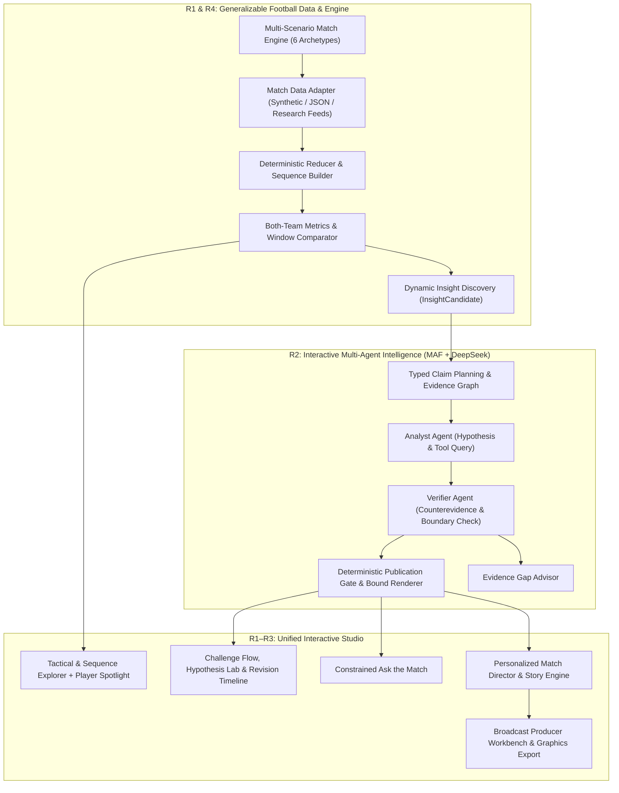

# MatchLens AI — Product Vision & Strategic Positioning

## 1. 产品定义与核心定位

- **项目名称**：MatchLens AI — Interactive Football Intelligence & Broadcast Studio
- **核心标语（Core Tagline）**：**Football Intelligence You Can Challenge.**
- **产品形态**：围绕赛事数据、战术理解、多 Agent 证据博弈、观众/分析师交互和转播内容制作构建的综合智能工作台（Interactive Football Intelligence & Broadcast Studio）。

MatchLens AI 绝不仅仅是一个“解释三个预设章节的 AI 仪表盘”或“套壳比赛数据生成解说词的聊天框”。在现代足球数据与赛事转播中，最大的痛点不是“缺少统计指标”或“缺少流畅的 AI 解说文本”，而是**表象数据与真实球场威胁之间的叙事失真**——例如高控球率被草率包装为“场面统治”，几次反击射门被夸大为“全场成功的高位逼抢战术”。

MatchLens AI 将**确定性赛事计算（Deterministic Football Engine）**、**对抗性双 Agent 证据核查（Adversarial Analyst-Verifier Collaboration）**与**可交互质疑及转播制作工作流（Interactive Challenge & Broadcast Studio）**融为一体，让每一条足球洞察都可追溯、可质疑、可验证、可发布。

---

## 2. 五大核心支柱能力（Five Core Pillars）

1. **Understand the Match（深度理解比赛）**
   - 跨越主客队与全场时间轴，精确还原球权归属、空间推进（Progressive Passes / Final-Third Entries）、连续进攻序列（Possession Sequences）与关键球员贡献（Player Spotlight）。
   - 严格区分**可观测有球事件（On-ball Events）**与不可观测的无球跑动/阵型意图，杜绝伪造战术概念。

2. **Discover What Matters（自主发现关键动态）**
   - 基于事件边界与滑动/自定义时间窗口，动态扫描双队战术背离（控球与渗透背离）、快速攻防转换爆发、连续推进序列异常与比分转折，生成结构化 `InsightCandidate`。

3. **Reason with Evidence（基于证据的多 Agent 推理）**
   - 基于 Microsoft Agent Framework 构建独立的 **Analyst Agent（假设提出与证据组织）** 与 **Verifier Agent（反证检索、样本充分性审查与因果越界拦截）**。
   - 通过 Typed Claim Plan 与确定性 Publication Gate，确保发布的每一项判断（Supported / Qualified / Withheld）都绑定不可篡改的 `Snapshot` 与 `Receipt`。

4. **Interact with the Viewer（可质疑、可探索的交互智能）**
   - 用户不再是被动阅读者：可以通过 **Tactical Hypothesis Lab** 比较竞争性解释，通过 **Challenge an Insight** 发起反证复核并查看 **Challenge & Revision Timeline**，或通过受约束的 **Ask the Match** 与 **Evidence Gap Advisor** 探索比赛并明确认知边界。

5. **Produce Broadcast Intelligence（个性化叙事与转播级内容生产）**
   - 同一套经过验证的事实底座（Single Source of Verified Truth），通过 **Personalized Match Director** 动态驱动 **Fan View**（简洁结果与看点）、**Analyst View**（窗口对比、分母、局限性）与 **Broadcast Producer Workbench**（审校队列、Lower-Third 字幕、故事线卡片与 SVG/JSON 导出）。

---

## 3. 目标用户画像与共享底座设计

MatchLens AI 面向三类核心用户，但**拒绝构建三个割裂的子应用**。三类用户共享同一套事件流（Event Stream）、指标收据（Metric Receipts）、快照哈希（Snapshot SHA-256）与双 Agent 验证管线，仅在**信息密度、交互入口与输出契约**上分层：

| 用户角色 | 核心痛点 | MatchLens 核心价值 | 核心使用视图与模块 |
| :--- | :--- | :--- | :--- |
| **Football Fans（球迷观众）** | 看完比赛或片段只看到比分和笼统解说，难以快速看懂“为什么控球多却没威胁”、“刚才的进球是怎么配合出来的”，也无法按自己支持的球队/球员聚焦。 | 零门槛理解比赛转折点、追踪主队或喜爱球员的关键参与序列，随时点击“用证据挑战”查看球场落点。 | `Fan View`、`Personalized Match Director`（关注球队/球员）、`Player Spotlight`、`Personalized Match Story` |
| **Football Analysts（战术与数据分析师）** | 传统数据面板只有静态汇总表，AI 解说经常把短期巧合当因果、忽略时间窗口分母；排查一段进攻序列或对比两个时间段需要繁琐的手动筛选。 | 自由切换主客队与时间窗口，探索传球网络与推进序列，检验竞争性战术假设，审计反证与数据缺失边界。 | `Analyst View`、`Tactical Explorer`、`Possession Sequence Explorer`、`Compare Match Windows`、`Tactical Hypothesis Lab`、`Challenge & Revision Timeline` |
| **Broadcast Producers（赛事转播与内容制作人）** | 直播或赛后制作时间极度紧张，AI 自动生成的洞察不敢直接上屏（怕数据出错或过度吹捧），缺乏“发现—核查—人工审校—包装导出”的闭环工作台。 | 自动接收经 Verifier 核查的候选洞察，一键预览证据链与置信边界，在审校队列中批准/退回，直接生成带时间戳与来源的转播字幕（Lower-Third）和故事卡。 | `Broadcast View`、`Broadcast Producer Workbench`、`Broadcast Graphics & Export`、`Personalized Match Story` |

---

## 4. 最终产品版图（R0.2 → R4 全景）

---

## 5. 核心竞争优势与差异化（Why MatchLens Wins）

在国际 Hackathon 评审与真实体育科技市场（对比 OptaAI Studio、通用大模型聊天助手、传统统计面板）中，MatchLens AI 的三大护城河是：

1. **Adversarial Verification over Blind Storytelling（对抗性证据核查而非盲目生成）**
   - 普通 AI 体育工具的目标是“把话圆得像解说员”，而 MatchLens 的核心机制是 **Analyst Proposes → Verifier Challenges → Deterministic Gate Decides**。当控球率上升但射门和进攻三区进入下降时，系统主动拒绝“场面占优”的陈词滥调；当用户质疑某条结论时，系统调取反证并公开修订记录（Maintained / Qualified / Withdrawn）。
2. **Event-Grounded Spatial & Sequence Semantics（事件级空间与连续序列语义，严守证据边界）**
   - 我们的 `Tactical Explorer` 与 `Possession Sequence Explorer` 将每一个统计数字（Receipt）直接锚定到球场坐标 `(x, y)` 和连续控球链（`Recovery → Progressive Pass → Entry → Shot`）。同时，通过 `Evidence Gap Advisor` 诚实区分“有球事件可证明的事实”与“需要追踪数据才能证明的阵型/压迫”，展现专业级分析严谨度。
3. **One Fact Base, Three Studio Workflows（一套事实底座驱动球迷、分析与转播生产）**
   - 从实时事件流自动发现候选时刻，到多 Agent 核查，再到球迷故事线与转播制作人审校队列（Editorial Queue + Lower-Third / SVG / JSON 导出），完整闭环了 Microsoft × Premier League 赛题所期待的 `Ingest → Interpret → Explain → Render → Personalize` 全链路。
