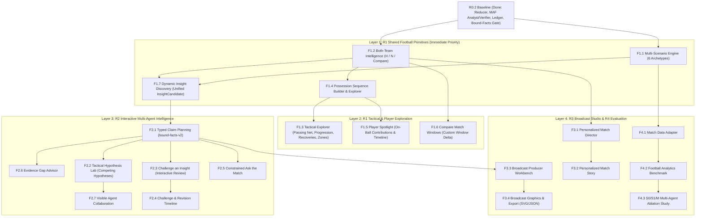

# MatchLens AI — Revised Product & Engineering Roadmap (R1–R4)

- **当前时间基线**：2026-10-20 PT (`America/Los_Angeles`)
- **比赛功能冻结目标（Feature Freeze）**：**2026-10-25 18:00 PT**
- **部署、彩排与视频录制专享日**：**2026-10-26 全天**
- **内部提交目标**：**2026-10-27 18:00 PT**（官方截止 `2026-10-27 23:59 PT`，评审期持续至 `2026-11-10 23:59 PT`）

---

## 1. 全量功能依赖图（Master Dependency DAG）

所有 R1–R4 功能均纳入正式产品路线图，严格按照底层共享原语到高层交互的依赖顺序推进：

---

## 2. 赛前冲刺日程表（Oct 20 – Oct 27, 2026 PT）

| 日期 | 阶段主题 | 核心交付任务（按优先级排序） | 每日验收门控（Done Criteria） | 工期不足时的降级/压缩策略 |
| :--- | :--- | :--- | :--- | :--- |
| **Oct 20** (今日) | **架构规划 + R1-S1 纵向切片落地** | 1. 完成 R1–R4 全套 8 份架构与产品规划文档 2. 实现 **R1-S1**：6 大战术场景生成器 (`SCENARIOS`)、主客队全对称收据 (`H.*` & `N.*`)、双队候选发现 (`InsightCandidate`)、连续控球序列 (`PossessionSequence`) 与前端场景/球队切换 | 原有 50 项 pytest + 新增 R1 多场景/双队/序列测试 100% 通过；前端可切换 6 个场景与主客队视角且不破坏 Seed 17 历史收据 | 保持 UI 紧凑，不改写底层 SSE 协议 |
| **Oct 21** | **R1-S2/S3 空间战术与序列探索** | 1. 完成 `Tactical Explorer` 图层切换（传球网络、推进传球、抢断分布、三区分布） 2. 完成 `Possession Sequence Explorer` 序列高亮与回放 3. 集成 `Player Spotlight` 核心统计 | 用户可在球场上切换图层并点击序列/球员定位到具体事件坐标；严格标注有球事件边界 | `Compare Match Windows` 先支持预设高频窗口组合 |
| **Oct 22** | **R2 核心：Hypothesis Lab + Challenge + Evidence Gap** | 1. 实现 `Typed Claim Plan` 与 `Tactical Hypothesis Lab`（竞争性假设对比与核查） 2. 实现交互式 `Challenge an Insight` 与 `Evidence Gap Advisor` 3. 升级 `Visible Agent Collaboration` 视图 | 用户可查看同一现象下的多个竞争性假设及正反证据；点击 Challenge 可触发复核并显示 `Maintained / Narrowed / Withdrawn` | `Ask the Match` 采用受控意图选择器而非开放自由输入框 |
| **Oct 23** | **R3 核心：Personalized Director + Broadcast Workbench** | 1. 实现 `Personalized Match Director`（关注主/客队、三视图切换） 2. 实现 `Broadcast Producer Workbench`（待审队列、Approve/Reject、JSON/SVG 导出） | 同一批验证事实在 Fan / Analyst / Broadcast 三视图下呈现清晰差异；制作人可批准卡片并导出 Overlay Payload | 复杂 PNG 光栅化延后至赛后，赛前专注 SVG/JSON 导出 |
| **Oct 24** | **公网部署 + 真实模型端到端验证** | 1. 构建单容器镜像并部署至已授权公网主机（单 Worker + 持久化 `/data/matchlens`） 2. 配置专项生产/评审预算额度，验证公网 DeepSeek 连通性与 10 分钟 SSE 稳定性 | 公网 URL 可免登录访问；至少跑通 B 章节及新场景的真实模型验证并归档收据 | 若公网网关裁剪长连接，自动平滑降级至已内置的 2s Polling |
| **Oct 25** (18:00 PT Freeze) | **Feature Freeze + 基准测试与文档定稿** | 1. 18:00 PT 严格冻结代码功能、Prompt 与门控阈值 2. 运行跨场景确定性 Benchmark（若预算充裕则运行轻量级 S0/S1/M 对照） 3. 更新英文 `README.md` 与 `DEMO_PLAN.md` | 全量测试套件零失败；所有未运行实验诚实标记 `NOT RUN`；锁定 Release Candidate SHA | 绝不在 18:00 后引入新契约或未验证功能 |
| **Oct 26** (全天保留) | **部署巡检、全流程彩排与 <120s 视频录制** | 1. 执行三次全新会话端到端彩排（Three Clean Rehearsals） 2. 录制 1080p 真实浏览器操作视频（目标 115 秒，严格 `<120s`），配英文旁白与字幕 | 视频时长经媒体元数据确认为 `<120s`，公开链接免登录可看，画面数字与收据 100% 吻合 | 只修补阻塞演示的缺陷，绝不加新功能 |
| **Oct 27** (18:00 PT Submit) | **最终核查与正式提交** | 1. 核对官方规则、仓库匿名访问、公网测试链接与评审期预算（持续至 Nov 10） 2. 在 18:00 PT 前完成平台提交并归档确认回执 | 提交成功，保留 Release Commit SHA、镜像 ID 与全套运行证据包 | 预留 6 小时缓冲应对平台上传或网络问题 |

---

## 3. 不可牺牲的提交红线（Non-Negotiable Submission Requirements）

1. **真实可访问的公网 Demo**：评审期内（至 2026-11-10 23:59 PT）免登录、免自备 API Key 即可体验完整功能。
2. **100% 诚实的证据与来源标识**：严格区分 `Real model analysis`、`Historical real analysis` 与 `Deterministic fallback`；绝不泄露隐藏生成器标签给 Agent，绝不把合成赛事包装成真实英超比赛。
3. **预算安全铁律**：严禁删除或重置 `.runtime/budget.sqlite3` 绕过限额；所有真实模型请求必须先在账本中原子预留。
4. **小于 120 秒的高水准英文演示视频**：在 2 分钟内清晰传递“发现异常 → 双 Agent 对抗核查 → 证据挑战与转播输出”的完整价值。

---

## 4. 赛后产品演进计划（Post-Hackathon Expansion: Nov 2026+）

- **Phase P-1（2026 年 11 月中旬）**：完成完整的 72 工作流 `S0 vs S1 vs M` 盲评对照研究并发布技术报告；完善五段式 `Personalized Match Story` 编辑器与多尺寸 PNG 转播图文导出。
- **Phase P-2（2026 年 12 月）**：上线完整的 `Match Data Adapter` 外部公共研究数据集（StatsBomb Open Data / Wyscout）导入管线，支持 90 分钟全场比赛事件流回放与分半场方向自动翻转。
- **Phase P-3（2027 Q1）**：探索可选的球员追踪（Tracking Data）扩展图层，在具备真实 22 人坐标的数据源上解锁经校准的阵型识别与压迫强度计算。
